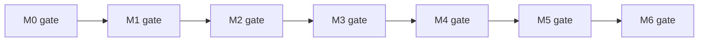

# HarborOps Execution Graph

**Version:** 1.0  
**Date:** 2026-10-30  
**Status:** Planning dependency model. Current implementation and verification are tracked in [Status](STATUS.md).

This file is generated from [execution-graph.json](execution-graph.json), the authoritative source for work-package IDs, prerequisites, and verification intentions. Do not edit this file directly. Regenerate with `node scripts/render-execution-graph.mjs` and check with `node scripts/render-execution-graph.mjs --check`.

## Gate sequence

Each gate is an evidence-based checkpoint. A gate may be verified only when its incoming work packages and applicable [Acceptance Criteria](ACCEPTANCE_CRITERIA.md) have executed successfully. Passing verification leads to **acceptance pending** until acceptance is explicitly confirmed.

## Work-package dependency graph

```mermaid
flowchart TD
  subgraph M0["M0: Engineering baseline"]
    M0_01["M0-01: Assess code and design"]
    M0_02["M0-02: Build and test foundations"]
    M0_03["M0-03: Verify migration and seed"]
    M0_04["M0-04: Verify local stack and browser"]
    M0_05["M0-05: Verify failure and hygiene"]
    G0["G0: GATE: Engineering baseline gate"]
  end
  subgraph M1["M1: Identity and shipment operations"]
    M1_01["M1-01: Resolve identity and ID policy"]
    M1_02["M1-02: Implement identity and scopes"]
    M1_03["M1-03: Implement maritime references"]
    M1_04["M1-04: Implement shipment lifecycle"]
    M1_05["M1-05: Verify scoped browser workflow"]
    G1["G1: GATE: Shipment operations gate"]
  end
  subgraph M2["M2: Tracking integrity"]
    M2_01["M2-01: Pin event contracts and durability"]
    M2_02["M2-02: Implement authenticated event inbox"]
    M2_03["M2-03: Implement resilient processing"]
    M2_04["M2-04: Implement timeline and exceptions"]
    M2_05["M2-05: Verify end-to-end event flow"]
    G2["G2: GATE: Tracking integrity gate"]
  end
  subgraph M3["M3: Operational analytics"]
    M3_01["M3-01: Define KPI and map policies"]
    M3_02["M3-02: Implement search and secure export"]
    M3_03["M3-03: Implement reconciled dashboards"]
    M3_04["M3-04: Implement route and exception UX"]
    G3["G3: GATE: Analytics gate"]
  end
  subgraph M4["M4: Security and IT operations"]
    M4_01["M4-01: Harden authorization and audit"]
    M4_02["M4-02: Implement telemetry and alerting"]
    M4_03["M4-03: Implement service incidents"]
    M4_04["M4-04: Verify fault-to-recovery incident"]
    G4["G4: GATE: Operations gate"]
  end
  subgraph M5["M5: Reliability and deployment"]
    M5_01["M5-01: Prove migration and restoration"]
    M5_02["M5-02: Benchmark and security review"]
    M5_03["M5-03: Validate deployment cost boundary"]
    G5["G5: GATE: Reliability gate"]
  end
  subgraph M6["M6: Release demonstration"]
    M6_01["M6-01: Polish accessibility and states"]
    M6_02["M6-02: Rehearse complete product scenarios"]
    M6_03["M6-03: Audit release evidence and docs"]
    G6["G6: GATE: Release readiness gate"]
  end
  M0_01 --> M0_02
  M0_01 --> M0_03
  M0_02 --> M0_04
  M0_03 --> M0_04
  M0_04 --> M0_05
  M0_02 --> G0
  M0_03 --> G0
  M0_04 --> G0
  M0_05 --> G0
  G0 --> M1_01
  M1_01 --> M1_02
  M1_01 --> M1_03
  M1_02 --> M1_04
  M1_03 --> M1_04
  M1_04 --> M1_05
  M1_02 --> G1
  M1_03 --> G1
  M1_04 --> G1
  M1_05 --> G1
  G1 --> M2_01
  M2_01 --> M2_02
  M2_02 --> M2_03
  M2_03 --> M2_04
  M2_04 --> M2_05
  M2_02 --> G2
  M2_03 --> G2
  M2_04 --> G2
  M2_05 --> G2
  G2 --> M3_01
  G2 --> M3_02
  M3_01 --> M3_03
  M3_02 --> M3_03
  M3_01 --> M3_04
  M3_03 --> M3_04
  M3_02 --> G3
  M3_03 --> G3
  M3_04 --> G3
  G3 --> M4_01
  G3 --> M4_02
  M4_02 --> M4_03
  M4_01 --> M4_04
  M4_03 --> M4_04
  M4_01 --> G4
  M4_02 --> G4
  M4_03 --> G4
  M4_04 --> G4
  G4 --> M5_01
  G4 --> M5_02
  G4 --> M5_03
  M5_01 --> G5
  M5_02 --> G5
  M5_03 --> G5
  G5 --> M6_01
  M6_01 --> M6_02
  M6_02 --> M6_03
  M6_03 --> G6
```

## Work packages and verification expectations

| ID | Depends on | Deliverable / outcome | Required evidence | Requirement links |
| --- | --- | --- | --- | --- |
| **M0-01** | None | Inventory current M0 source, decisions, prerequisites, and known defects | Branch and implementation inventory recorded | NFR-008 |
| **M0-02** | M0-01 | Clean .NET build, unit/contract tests, frontend test and build | Actual command results and failures recorded | NFR-008 |
| **M0-03** | M0-01 | PostgreSQL migration, deterministic row and repeatable seed | Real PostgreSQL integration and repeat migration checks | FR-017, NFR-007, NFR-008 |
| **M0-04** | M0-02, M0-03 | Compose startup and browser -> API -> PostgreSQL read path | Clean Compose launch, HTTP status, browser observation | FR-015, NFR-001, NFR-008 |
| **M0-05** | M0-04 | Liveness/readiness outage, dependency and secret checks | Controlled outage/recovery and hygiene logs | FR-015, NFR-003, NFR-008 |
| **G0** (gate) | M0-02, M0-03, M0-04, M0-05 | M0 evidence ledger and acceptance review | All M0 acceptance checks evidenced | FR-015, FR-017, NFR-001, NFR-008 |
| **M1-01** | G0 | Close D-001 and D-003; model organizations and identifiers | Decision log and schema/contract review | FR-001, FR-002, FR-005 |
| **M1-02** | M1-01 | Sessions, memberships, permission enforcement | Authentication lifecycle and negative access tests | FR-001, FR-002, NFR-002 |
| **M1-03** | M1-01 | Ports, vessels, voyages, containers and schema constraints | CRUD validation and database invariant tests | FR-003, FR-005 |
| **M1-04** | M1-02, M1-03 | Create/edit/archive, assignments, conflict protection | Transactional, concurrency, and assignment tests | FR-004, FR-005 |
| **M1-05** | M1-04 | Complete browser workflow and two-organization fixture matrix | Browser/API and cross-organization negative tests | FR-001, FR-002, FR-003, FR-004, FR-005 |
| **G1** (gate) | M1-02, M1-03, M1-04, M1-05 | M1 validation evidence and decision review | Acceptance sections A/D satisfied | FR-001, FR-002, FR-003, FR-004, FR-005 |
| **M2-01** | G1 | Resolve D-002/D-006, versioned schema, inbox and retry policy | Contract fixtures and decision log | FR-006, FR-007, FR-008 |
| **M2-02** | M2-01 | Authenticated ingestion, receipt and conflict records | Malformed, forged, replay, and durable-write tests | FR-006, FR-007, FR-008 |
| **M2-03** | M2-02 | Worker, transactional deduplication, retries, dead letters | Duplicate, crash-window, worker restart tests | FR-008, NFR-004 |
| **M2-04** | M2-03 | Immutable history, deterministic projection and delay rules | Rebuild, correction, ordering, conflict fixture tests | FR-009, FR-010 |
| **M2-05** | M2-04 | Receipt-to-timeline test and operational replay scenarios | DB outage, replay, negative-source tests | FR-006, FR-007, FR-008, FR-009, FR-010 |
| **G2** (gate) | M2-02, M2-03, M2-04, M2-05 | Recorded tracking reliability matrix | Acceptance section B satisfied | FR-006, FR-008, FR-009, FR-010 |
| **M3-01** | G2 | Close D-004/D-005, fixture definitions and tile fallback | Rules and licensing review | FR-012, FR-018 |
| **M3-02** | G2 | Scoped shipment filter, details and CSV export | Query, pagination, authorization matrix | FR-011, FR-013, NFR-002 |
| **M3-03** | M3-01, M3-02 | KPIs and source-row drill-through | Reconciliation of exact fixture totals | FR-012, FR-010 |
| **M3-04** | M3-01, M3-03 | Route view, exception inbox, scoped notifications | Browser access, simulated labels, recipient matrix | FR-018, FR-019, NFR-009 |
| **G3** (gate) | M3-02, M3-03, M3-04 | Reconciled user experience evidence | Acceptance section C satisfied | FR-011, FR-012, FR-013, FR-018, FR-019 |
| **M4-01** | G3 | Audit records, rate limiting, session and export regression | Security threat and isolation tests | FR-014, NFR-002, NFR-003 |
| **M4-02** | G3 | Health, structured logs, metrics, traces and alerts | Signals observable during controlled faults | FR-015, NFR-005 |
| **M4-03** | M4-02 | Incident lifecycle, evidence, root-cause and remediation | State transitions and role-boundary tests | FR-016, FR-020 |
| **M4-04** | M4-01, M4-03 | End-to-end detected failure and documented recovery | Incident evidence and sensitive-data checks | FR-014, FR-015, FR-016, FR-020 |
| **G4** (gate) | M4-01, M4-02, M4-03, M4-04 | Security and service readiness report | Acceptance sections D/E satisfied | FR-014, FR-015, FR-016 |
| **M5-01** | G4 | D-008 recovery targets, fresh/historical migration and isolated restore | Counts, constraints, queries and elapsed time evidence | NFR-011, NFR-012 |
| **M5-02** | G4 | Load baselines, dependency review, targeted security test | Dataset and p50/p95/p99 plus findings | NFR-003, NFR-010 |
| **M5-03** | G4 | D-007 decision, zero-cost local or explicitly approved hosted profile | Budget, shutdown and deployment evidence | NFR-001, NFR-012 |
| **G5** (gate) | M5-01, M5-02, M5-03 | Recoverability, security and cost report | Acceptance section F reliability requirements met | NFR-001, NFR-010, NFR-011, NFR-012 |
| **M6-01** | G5 | Consistent responsive UI, error, empty, forbidden and degraded views | Browser, keyboard and accessibility checks | NFR-009 |
| **M6-02** | M6-01 | Deterministic full fixture and D01-D06 scenarios | Scenario logs and expected-vs-actual checks | FR-017, NFR-004, NFR-005 |
| **M6-03** | M6-02 | Release documentation, known limitations and acceptance evidence | Requirements traceability, docs and reproducibility audit | NFR-008 |
| **G6** (gate) | M6-03 | Release readiness report; acceptance pending until explicit approval | All applicable acceptance criteria satisfied | NFR-002, NFR-008, NFR-009 |

## Execution protocol

1. Select the next incomplete work package whose dependencies have corresponding verification evidence. Dependencies are necessary conditions, not evidence that the next task works.
2. Recheck branch HEAD and actual source state before implementation. The graph plans work; it never asserts code completion.
3. Implement bounded scope with tests, migration review, security review, and documentation updates appropriate to the node.
4. Record exact revision, commands, environment, expected and observed outcomes, failures, and evidence in [Status](STATUS.md) or the linked milestone verification register.
5. Do not close a gate with skipped required tests, unverified browser behavior, unresolved blocker defects, or source-only assertions.
6. For changes to dependencies or work-package identifiers, edit [execution-graph.json](execution-graph.json), regenerate this document, and update [Roadmap](ROADMAP.md), [PRD](PRD.md), and acceptance records where affected.

## Execution semantics

- Arrows mean **must complete and verify prerequisite before proceeding**. Independent nodes inside a milestone may run concurrently where no edge connects them.
- G0-G6 are milestone gates. All work-package paths within a milestone must reach that milestone gate.
- Each later milestone begins only through the preceding gate. A gate being implemented but not verified is not sufficient.
- The graph does not maintain runtime status. [Status](STATUS.md) is the only current-state ledger.
- Requirement references point to [Requirements](REQUIREMENTS.md); detailed tests live in [Test Strategy](TEST_STRATEGY.md) and [Acceptance Criteria](ACCEPTANCE_CRITERIA.md).

## Current starting point

Start with the actual M0 feature-branch assessment and outstanding verification in [Status](STATUS.md). Do not treat M1-M6 as delivered based on this planning graph.
