# HarborOps Execution Graph

**Version:** 2.0  
**Date:** 2026-10-30  
**State:** Delivery dependency plan, not observed runtime status.

## Authority and use

The authoritative work-package dataset is [execution-graph.json](execution-graph.json). This document is generated by [scripts/render-execution-graph.mjs](../scripts/render-execution-graph.mjs). Edit JSON first, then run `node scripts/render-execution-graph.mjs`; verify exact consistency with `node scripts/render-execution-graph.mjs --check`.

The [PRD](PRD.md) defines product scope; [Roadmap](ROADMAP.md) defines milestone boundaries and gate obligations; [Requirements](REQUIREMENTS.md) owns atomic FR/NFR identifiers; [Acceptance Criteria](ACCEPTANCE_CRITERIA.md) defines checks; [Status](STATUS.md) exclusively records executed evidence, progress, and acceptance. Graph nodes are planned work and cannot be treated as implemented solely because they exist.

**Granularity:** 25 independently gated milestones, 101 scoped work packages, 25 verification gates, 226 dependency edges across 6 delivery stages.

## Navigation

| Stage | Milestones | Focus |
| --- | --- | --- |
| [P0: Foundation and maritime records](#stage-p0-foundation-and-maritime-records) | M0, M1, M2, M3, M4, M5, M6 | Foundation and maritime records |
| [P1: Event ingestion and decision rules](#stage-p1-event-ingestion-and-decision-rules) | M7, M8, M9, M10, M11 | Event ingestion and decision rules |
| [P2: Operational workspaces](#stage-p2-operational-workspaces) | M12, M13, M14, M15 | Operational workspaces |
| [P3: Security and technical operations](#stage-p3-security-and-technical-operations) | M16, M17, M18 | Security and technical operations |
| [P4: Reliability and delivery assurance](#stage-p4-reliability-and-delivery-assurance) | M19, M20, M21, M22 | Reliability and delivery assurance |
| [P5: Release finish](#stage-p5-release-finish) | M23, M24 | Release finish |

## High-level stage dependency

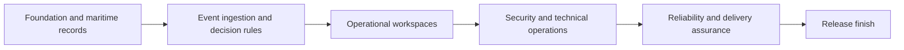

Gate transitions are sequential. Within a single milestone, tasks that branch from the same prerequisite may be implemented independently and then reunited at verification. Every work package is a narrow, reviewable output with specific tests.

## Milestone gate map

### P0: Foundation and maritime records

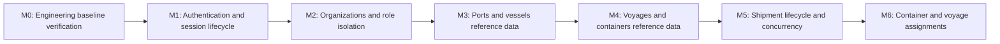

### P1: Event ingestion and decision rules

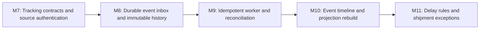

### P2: Operational workspaces

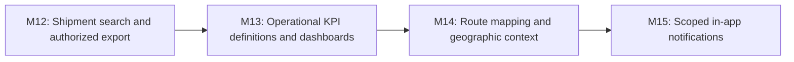

### P3: Security and technical operations

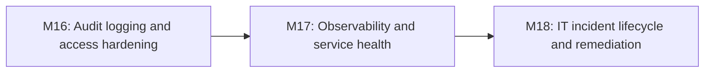

### P4: Reliability and delivery assurance

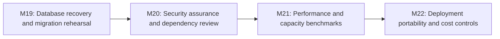

### P5: Release finish

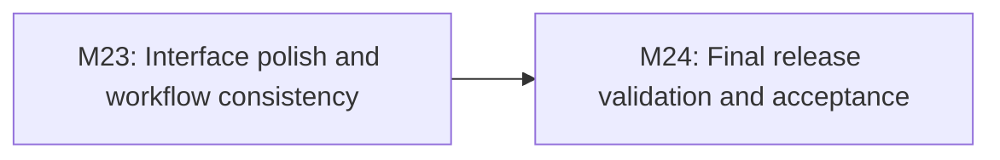

## Legacy identifier migration

Execution graph v1 contained M0-M6. M0-01 through M0-05 and G0 are preserved. **Old M1-M6 node IDs and G1-G6 are superseded and must not be interpreted as the new tasks or completion states.** The old-to-new milestone mapping is documented in [Roadmap](ROADMAP.md). New planning IDs do not rewrite code history or retroactively mark any capability delivered.

## Stage P0: Foundation and maritime records

### M0: Engineering baseline verification

**Outcome:** Verify the existing source-only foundation against real runtime evidence  
**Entry:** Current M0 code assessment; no prior runtime gate.  
**Architecture decisions:** No additional decisions identified for this milestone.  
**Exit gate:** G0, requiring all 5 work-package outcomes and their actual verification results.

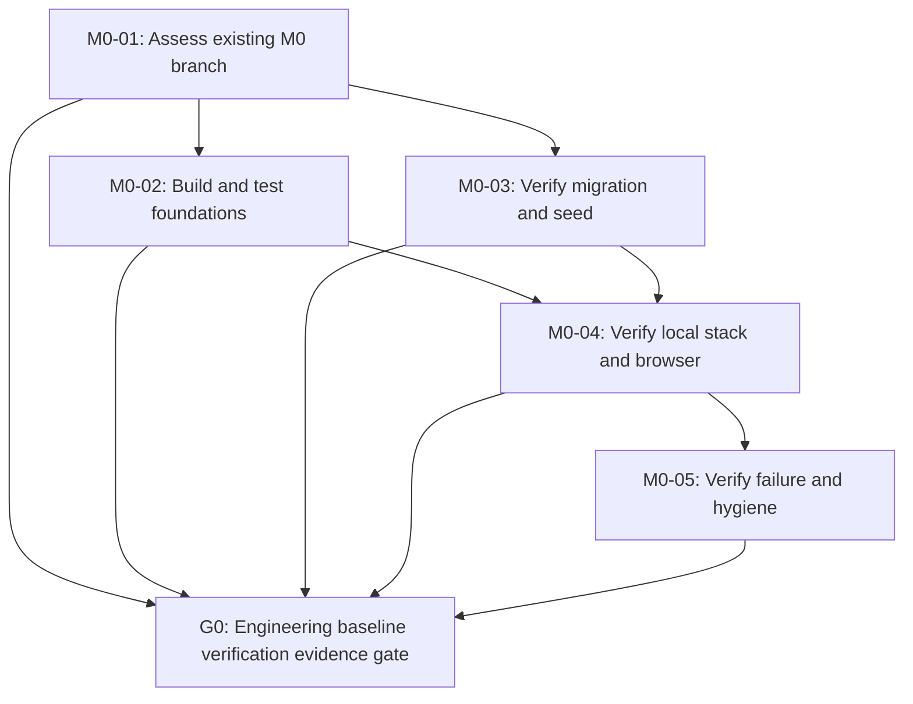

| Work package | Prerequisites | Specific deliverable | Verification requirement | FR/NFR links |
| --- | --- | --- | --- | --- |
| **M0-01: Assess existing M0 branch** | None | Inventory existing API, React, PostgreSQL, migration and Compose code | Document branch HEAD, known blockers and source inventory | NFR-008 |
| **M0-02: Build and test foundations** | M0-01 | Execute clean .NET restore/build, unit and contract tests, plus web build | Record exact .NET and Node commands and results | NFR-008 |
| **M0-03: Verify migration and seed** | M0-01 | Run migrations and repeatable deterministic seed against disposable PostgreSQL | Real PostgreSQL integration results and seed assertions | FR-017, NFR-007 |
| **M0-04: Verify local stack and browser** | M0-02, M0-03 | Prove Docker Compose and browser to API to PostgreSQL request path | Observe clean startup, health and real browser state | FR-015, NFR-001 |
| **M0-05: Verify failure and hygiene** | M0-04 | Test unavailable database, readiness/liveness, secrets and dependencies | Fault evidence, recovery and security review | FR-015, NFR-003 |

**G0 acceptance evidence:** Verified by GitHub Actions run 41134743879 on source fec7429415fede121db8a4a34f0df72cd4fac609; accepted on 2026-10-31.

### M1: Authentication and session lifecycle

**Outcome:** Secure login, session expiry, logout and account disablement  
**Entry:** G0 verified, with recorded evidence.  
**Architecture decisions:** D-001 must be resolved before applicable implementation.  
**Exit gate:** G1, requiring all 4 work-package outcomes and their actual verification results.


| Work package | Prerequisites | Specific deliverable | Verification requirement | FR/NFR links |
| --- | --- | --- | --- | --- |
| **M1-01: Lock authentication contract** | G0 | Document local account, browser session, CSRF and integration-credential boundaries | Security decision recorded and negative case matrix defined | FR-001, NFR-002 |
| **M1-02: Build credential and session store** | M1-01 | Persist account credentials safely, session lifecycle and server-side expiry | Password, sign-in, expiry and replay unit/integration tests | FR-001, NFR-003 |
| **M1-03: Implement login and logout endpoints** | M1-01 | Deliver browser login, logout, account-disable and safe errors | Invalid credentials, disabled account and invalidation API tests | FR-001, NFR-006 |
| **M1-04: Verify session lifecycle end to end** | M1-02, M1-03 | Connect browser sign-in state, protected session checks and logout | Browser/API tests plus session invalidation evidence | FR-001, NFR-002 |

**G1 acceptance evidence:** All applicable tasks, negative tests, runtime evidence and documentation for M1 recorded; acceptance pending until explicitly confirmed.

### M2: Organizations and role isolation

**Outcome:** Explicit memberships, roles and organization-scoped access  
**Entry:** G1 verified, with recorded evidence.  
**Architecture decisions:** No additional decisions identified for this milestone.  
**Exit gate:** G2, requiring all 4 work-package outcomes and their actual verification results.

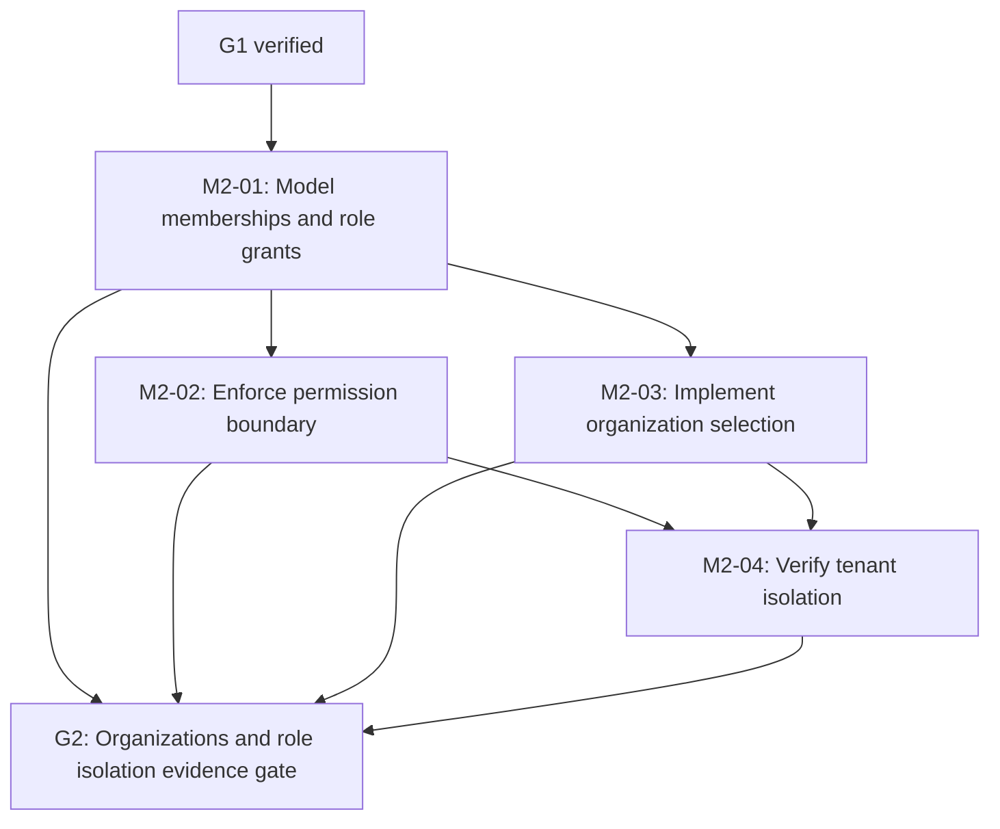

| Work package | Prerequisites | Specific deliverable | Verification requirement | FR/NFR links |
| --- | --- | --- | --- | --- |
| **M2-01: Model memberships and role grants** | G1 | Create organization, membership, role and disabled-state schema | Migration, cardinality and membership tests | FR-002, NFR-002 |
| **M2-02: Enforce permission boundary** | M2-01 | Server policy denies unauthorized role, organization and object access | Policy unit and wrong-role API tests | FR-002, NFR-002 |
| **M2-03: Implement organization selection** | M2-01 | Expose authenticated membership context and selected organization | No trust in route org identifier; role-switch tests | FR-002, FR-001 |
| **M2-04: Verify tenant isolation** | M2-02, M2-03 | Exercise two-organization matrix across protected test endpoints | Cross-tenant, disabled membership and ID enumeration tests | FR-002, NFR-002 |

**G2 acceptance evidence:** All applicable tasks, negative tests, runtime evidence and documentation for M2 recorded; acceptance pending until explicitly confirmed.

### M3: Ports and vessels reference data

**Outcome:** Validated, queryable and scoped port/vessel reference records  
**Entry:** G2 verified, with recorded evidence.  
**Architecture decisions:** No additional decisions identified for this milestone.  
**Exit gate:** G3, requiring all 4 work-package outcomes and their actual verification results.


| Work package | Prerequisites | Specific deliverable | Verification requirement | FR/NFR links |
| --- | --- | --- | --- | --- |
| **M3-01: Specify port and vessel invariants** | G2 | Define identifiers, ownership, allowable changes and synthetic fixtures | Domain-rule review and invalid fixture cases | FR-003, FR-017 |
| **M3-02: Implement port persistence and endpoints** | M3-01 | Add port schema, lookup and validation with bounded responses | Migration, lookup and bad-input tests | FR-003, NFR-006 |
| **M3-03: Implement vessel persistence and endpoints** | M3-01 | Add vessel schema and IMO/MMSI validation where applicable | Uniqueness, invalid ID and authorized API tests | FR-003, NFR-002 |
| **M3-04: Verify reference data browser flow** | M3-02, M3-03 | Build basic port and vessel views and scoped lookup interactions | Browser smoke and organization authorization tests | FR-003 |

**G3 acceptance evidence:** All applicable tasks, negative tests, runtime evidence and documentation for M3 recorded; acceptance pending until explicitly confirmed.

### M4: Voyages and containers reference data

**Outcome:** Validated voyage schedules and container identity models  
**Entry:** G3 verified, with recorded evidence.  
**Architecture decisions:** D-003 must be resolved before applicable implementation.  
**Exit gate:** G4, requiring all 4 work-package outcomes and their actual verification results.

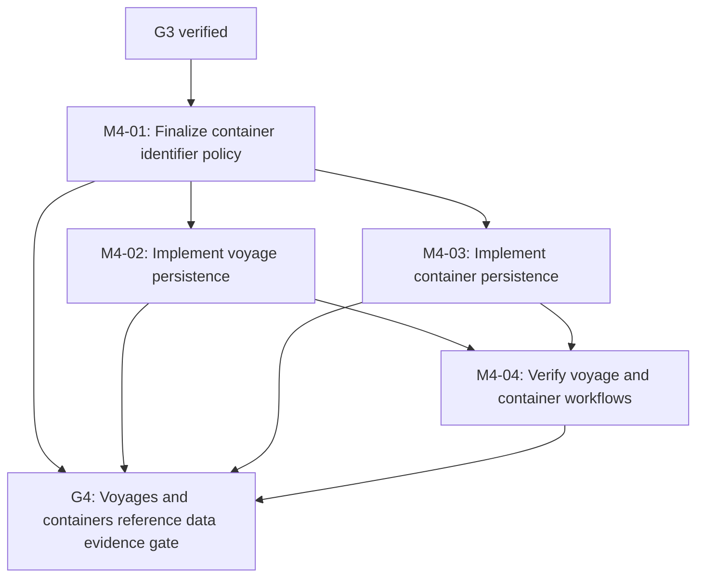

| Work package | Prerequisites | Specific deliverable | Verification requirement | FR/NFR links |
| --- | --- | --- | --- | --- |
| **M4-01: Finalize container identifier policy** | G3 | Close D-003 and capture synthetic ID rules and constraints | Decision documented with positive/negative examples | FR-005, FR-017 |
| **M4-02: Implement voyage persistence** | M4-01 | Link vessels, ports and coherent planned/actual time windows | Time-order and missing-value database/API tests | FR-003, NFR-007 |
| **M4-03: Implement container persistence** | M4-01 | Store equipment type, identifier and lifecycle reference | Uniqueness, format, state and organization tests | FR-005, FR-003 |
| **M4-04: Verify voyage and container workflows** | M4-02, M4-03 | Expose create/detail/list with scoped browser controls | API, database and browser fixture regression | FR-003, FR-005 |

**G4 acceptance evidence:** All applicable tasks, negative tests, runtime evidence and documentation for M4 recorded; acceptance pending until explicitly confirmed.

### M5: Shipment lifecycle and concurrency

**Outcome:** Create, edit, search and archive organizational shipments  
**Entry:** G4 verified, with recorded evidence.  
**Architecture decisions:** No additional decisions identified for this milestone.  
**Exit gate:** G5, requiring all 4 work-package outcomes and their actual verification results.

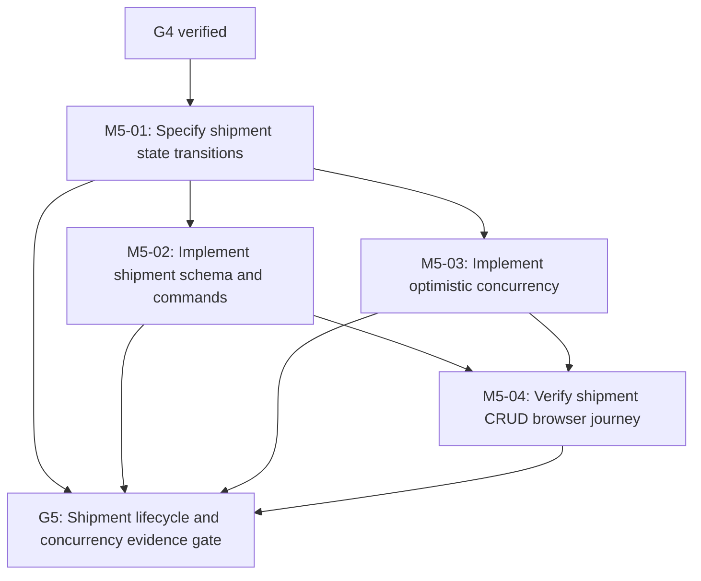

| Work package | Prerequisites | Specific deliverable | Verification requirement | FR/NFR links |
| --- | --- | --- | --- | --- |
| **M5-01: Specify shipment state transitions** | G4 | Define references, validation, status and archival policy | State-machine and invalid transition tests | FR-004 |
| **M5-02: Implement shipment schema and commands** | M5-01 | Create/edit/archive through organization-scoped services and endpoints | Migration, transaction and authorization tests | FR-004, FR-002 |
| **M5-03: Implement optimistic concurrency** | M5-01 | Require explicit version on conflicting shipment writes | Stale edit, repeated request and conflict tests | FR-004, NFR-006 |
| **M5-04: Verify shipment CRUD browser journey** | M5-02, M5-03 | Wire create, edit, list, detail and archive with error states | Browser/API replay and foreign organization denial tests | FR-004 |

**G5 acceptance evidence:** All applicable tasks, negative tests, runtime evidence and documentation for M5 recorded; acceptance pending until explicitly confirmed.

### M6: Container and voyage assignments

**Outcome:** Temporal and organization-safe shipment assignments  
**Entry:** G5 verified, with recorded evidence.  
**Architecture decisions:** No additional decisions identified for this milestone.  
**Exit gate:** G6, requiring all 4 work-package outcomes and their actual verification results.


| Work package | Prerequisites | Specific deliverable | Verification requirement | FR/NFR links |
| --- | --- | --- | --- | --- |
| **M6-01: Define assignment invariants** | G5 | Model active intervals, overlap policy and link ownership | Domain edge cases and conflicting scenarios | FR-005 |
| **M6-02: Implement shipment-container links** | M6-01 | Persist assignment intervals with overlap safeguards | Overlap, foreign equipment and concurrent-write tests | FR-005, FR-002 |
| **M6-03: Implement shipment-voyage links** | M6-01 | Persist voyage association, transitions and reference validation | Cross-tenant and incompatible route tests | FR-005, FR-003 |
| **M6-04: Verify complete allocation journey** | M6-02, M6-03 | Create shipment, attach container/voyage and inspect links | Browser/API failure matrix plus Q1 disposable historical-volume compatibility checkpoint if a representative snapshot exists | FR-004, FR-005 |

**G6 acceptance evidence:** All applicable tasks, negative tests, runtime evidence and documentation for M6 recorded; acceptance pending until explicitly confirmed; include corresponding quarterly snapshot compatibility result or documented not-applicable reason.

## Stage P1: Event ingestion and decision rules

### M7: Tracking contracts and source authentication

**Outcome:** Versioned and authenticated event interface  
**Entry:** G6 verified, with recorded evidence.  
**Architecture decisions:** D-002 must be resolved before applicable implementation.  
**Exit gate:** G7, requiring all 4 work-package outcomes and their actual verification results.

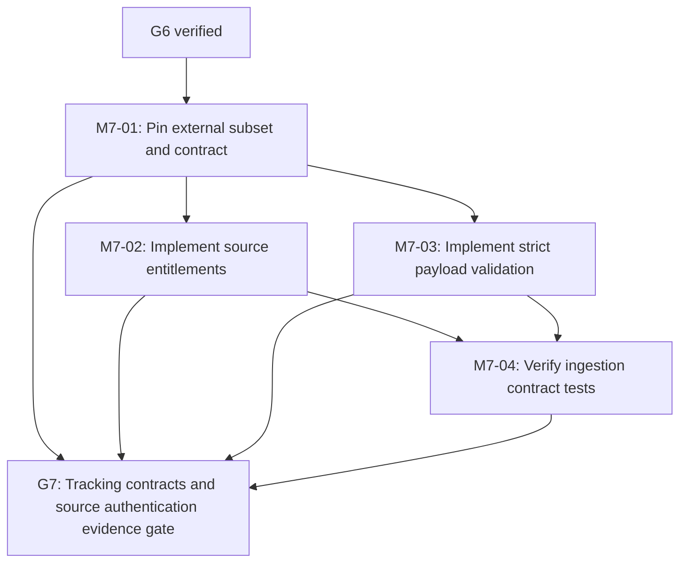

| Work package | Prerequisites | Specific deliverable | Verification requirement | FR/NFR links |
| --- | --- | --- | --- | --- |
| **M7-01: Pin external subset and contract** | G6 | Choose DCSA reference version, adapter fields and internal event contract | Decision, schema fixtures and mapping gap review | FR-006, FR-007 |
| **M7-02: Implement source entitlements** | M7-01 | Authenticate integration source and bind organization/source permissions | Forged source, token expiry and tenant-boundary tests | FR-007, FR-002 |
| **M7-03: Implement strict payload validation** | M7-01 | Bound sizes, timestamps, identifiers and supported event types | Malformed, oversize and unsupported variant tests | FR-007, NFR-006 |
| **M7-04: Verify ingestion contract tests** | M7-02, M7-03 | Publish versioned payload fixtures and safe error semantics | Positive/negative API contract tests with no secret exposure | FR-006, FR-007 |

**G7 acceptance evidence:** All applicable tasks, negative tests, runtime evidence and documentation for M7 recorded; acceptance pending until explicitly confirmed.

### M8: Durable event inbox and immutable history

**Outcome:** Transactional receipt persistence and accepted event provenance  
**Entry:** G7 verified, with recorded evidence.  
**Architecture decisions:** D-006 must be resolved before applicable implementation.  
**Exit gate:** G8, requiring all 4 work-package outcomes and their actual verification results.


| Work package | Prerequisites | Specific deliverable | Verification requirement | FR/NFR links |
| --- | --- | --- | --- | --- |
| **M8-01: Specify inbox and retention states** | G7 | Close durability decision and define source keys, receipts and outcomes | Decision plus crash-window and collision scenarios | FR-006, FR-008 |
| **M8-02: Implement receipt and event schema** | M8-01 | Create inbox and immutable history with unique source-scoped keys | Migration, duplicate index and append-only tests | FR-006, FR-008 |
| **M8-03: Implement intake transaction path** | M8-01 | Acknowledge only committed receipts and quarantine key collisions | Rollback, conflicting replay and authorization tests | FR-006, FR-007, FR-008 |
| **M8-04: Verify persistent ingestion behavior** | M8-02, M8-03 | Inspect raw provenance and receipt status across restart | Real database durability and retry-outcome tests | FR-006, NFR-004 |

**G8 acceptance evidence:** All applicable tasks, negative tests, runtime evidence and documentation for M8 recorded; acceptance pending until explicitly confirmed.

### M9: Idempotent worker and reconciliation

**Outcome:** At-least-once processing with effect-once business outcomes  
**Entry:** G8 verified, with recorded evidence.  
**Architecture decisions:** No additional decisions identified for this milestone.  
**Exit gate:** G9, requiring all 4 work-package outcomes and their actual verification results.

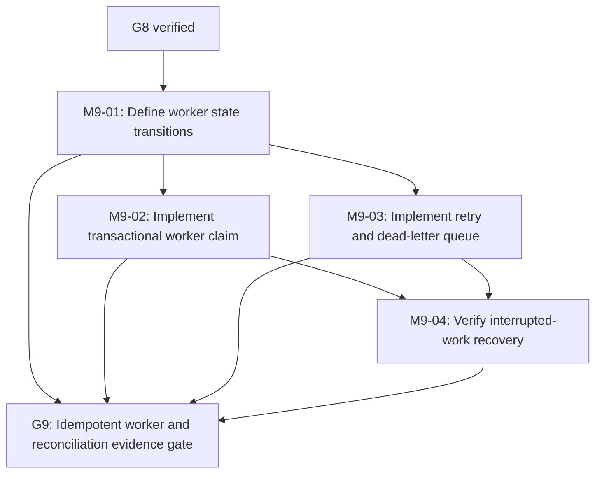

| Work package | Prerequisites | Specific deliverable | Verification requirement | FR/NFR links |
| --- | --- | --- | --- | --- |
| **M9-01: Define worker state transitions** | G8 | Set lease, retry budget, backoff and dead-letter disposition | Failure matrix, concurrency plan and timeout cases | FR-008, NFR-004 |
| **M9-02: Implement transactional worker claim** | M9-01 | Safely claim inbox work and commit processing effects | Two-worker race, restart and partial failure tests | FR-008, NFR-004 |
| **M9-03: Implement retry and dead-letter queue** | M9-01 | Bound transient retries; park permanent and unknown records | Retry exhaustion, replay and reconciliation tests | FR-007, FR-008 |
| **M9-04: Verify interrupted-work recovery** | M9-02, M9-03 | Terminate processing at controlled windows and restart | No lost receipts, duplicate effects or unbounded retry | FR-008, NFR-004 |

**G9 acceptance evidence:** All applicable tasks, negative tests, runtime evidence and documentation for M9 recorded; acceptance pending until explicitly confirmed.

### M10: Event timeline and projection rebuild

**Outcome:** Ordered history, current status and explicit correction handling  
**Entry:** G9 verified, with recorded evidence.  
**Architecture decisions:** No additional decisions identified for this milestone.  
**Exit gate:** G10, requiring all 4 work-package outcomes and their actual verification results.

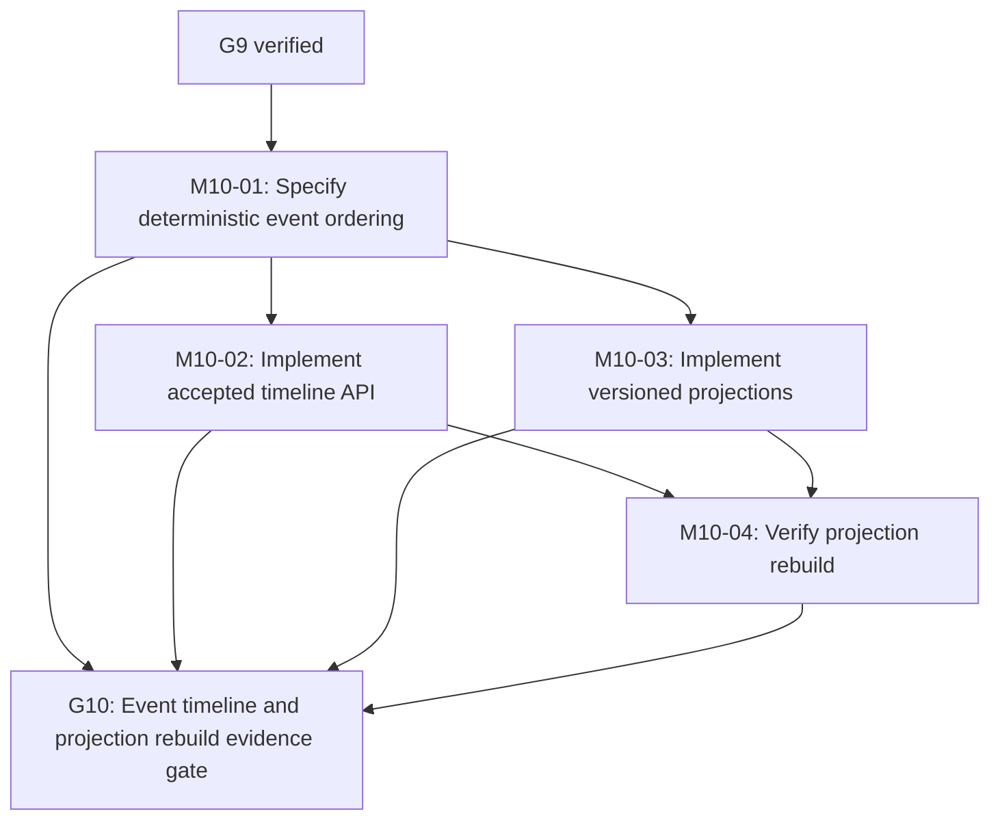

| Work package | Prerequisites | Specific deliverable | Verification requirement | FR/NFR links |
| --- | --- | --- | --- | --- |
| **M10-01: Specify deterministic event ordering** | G9 | Define occurrence, source sequence, ties and unknown state rules | Ordering and correction fixture specification | FR-009, NFR-007 |
| **M10-02: Implement accepted timeline API** | M10-01 | Expose scoped ordered history and provenance references | Pagination, timestamp and cross-organization tests | FR-009, FR-002 |
| **M10-03: Implement versioned projections** | M10-01 | Derive shipment status/ETA from immutable accepted events | Late delivery, correction and conflict unit tests | FR-009, NFR-004 |
| **M10-04: Verify projection rebuild** | M10-02, M10-03 | Recompute projections from history and compare expected results | Repeated rebuild checksum and restart correctness | FR-009, FR-008 |

**G10 acceptance evidence:** All applicable tasks, negative tests, runtime evidence and documentation for M10 recorded; acceptance pending until explicitly confirmed.

### M11: Delay rules and shipment exceptions

**Outcome:** Explainable at-risk, delay and conflict detection  
**Entry:** G10 verified, with recorded evidence.  
**Architecture decisions:** No additional decisions identified for this milestone.  
**Exit gate:** G11, requiring all 4 work-package outcomes and their actual verification results.


| Work package | Prerequisites | Specific deliverable | Verification requirement | FR/NFR links |
| --- | --- | --- | --- | --- |
| **M11-01: Specify delay classification rules** | G10 | Define tolerances, source confidence, cutoff and unknown handling | Rule examples and boundary test fixtures | FR-010, NFR-007 |
| **M11-02: Implement exception evaluation** | M11-01 | Evaluate accepted projected events into scoped exceptions | At-risk/delayed status and conflict regression | FR-010, FR-002 |
| **M11-03: Implement exception lifecycle** | M11-01 | Create, acknowledge and resolve exceptions with scoped actions | Unauthorized mutation, repeat and idempotency tests | FR-010, NFR-002 |
| **M11-04: Verify end-to-end exception flow** | M11-02, M11-03 | Inject delayed/corrected events, inspect rule and disposition | API/UI scenario with no spurious exceptions | FR-010, FR-009 |

**G11 acceptance evidence:** All applicable tasks, negative tests, runtime evidence and documentation for M11 recorded; acceptance pending until explicitly confirmed.

## Stage P2: Operational workspaces

### M12: Shipment search and authorized export

**Outcome:** Scoped filtering, detail navigation and CSV output  
**Entry:** G11 verified, with recorded evidence.  
**Architecture decisions:** No additional decisions identified for this milestone.  
**Exit gate:** G12, requiring all 4 work-package outcomes and their actual verification results.

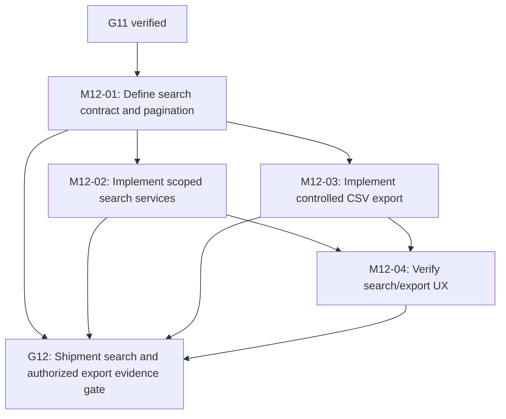

| Work package | Prerequisites | Specific deliverable | Verification requirement | FR/NFR links |
| --- | --- | --- | --- | --- |
| **M12-01: Define search contract and pagination** | G11 | Specify supported filters, bounded pages and stable ordering | Contract and filter edge-case fixtures | FR-011, NFR-006 |
| **M12-02: Implement scoped search services** | M12-01 | Filter shipment data without leaking organization records | Direct-ID, foreign filter and aggregate tests | FR-011, FR-002 |
| **M12-03: Implement controlled CSV export** | M12-01 | Export only authorized, filtered rows with safe CSV escaping | Foreign-tenant, injection and large export tests | FR-013, FR-002 |
| **M12-04: Verify search/export UX** | M12-02, M12-03 | Wire interactive filters, detail transitions and exports | Browser filtering and denied-export tests plus Q2 disposable historical-volume compatibility checkpoint if available | FR-011, FR-013 |

**G12 acceptance evidence:** All applicable tasks, negative tests, runtime evidence and documentation for M12 recorded; acceptance pending until explicitly confirmed; include corresponding quarterly snapshot compatibility result or documented not-applicable reason.

### M13: Operational KPI definitions and dashboards

**Outcome:** Reconciled, drillable throughput and delay metrics  
**Entry:** G12 verified, with recorded evidence.  
**Architecture decisions:** D-005 must be resolved before applicable implementation.  
**Exit gate:** G13, requiring all 4 work-package outcomes and their actual verification results.

```mermaid
flowchart TD
  M13_01["M13-01: Finalize KPI catalog and cutoffs"]
  M13_02["M13-02: Implement aggregate query services"]
  M13_03["M13-03: Build dashboard visualizations"]
  M13_04["M13-04: Verify dashboard correctness"]
  G13["G13: Operational KPI definitions and dashboards evidence gate"]
  G12["G12 verified"]
  G12 --> M13_01
  M13_01 --> M13_02
  M13_01 --> M13_03
  M13_02 --> M13_04
  M13_03 --> M13_04
  M13_01 --> G13
  M13_02 --> G13
  M13_03 --> G13
  M13_04 --> G13
```

| Work package | Prerequisites | Specific deliverable | Verification requirement | FR/NFR links |
| --- | --- | --- | --- | --- |
| **M13-01: Finalize KPI catalog and cutoffs** | G12 | Close D-005; define denominators, exclusions and UTC windows | Known fixture totals and rule review | FR-012, NFR-007 |
| **M13-02: Implement aggregate query services** | M13-01 | Compute scoped KPIs with consistent source-record joins | Exact fixture reconciliation and tenant denial | FR-012, FR-002 |
| **M13-03: Build dashboard visualizations** | M13-01 | Present status, trend, exceptions and drill-through views | Browser rendering and underlying row consistency | FR-012 |
| **M13-04: Verify dashboard correctness** | M13-02, M13-03 | Reconcile all displayed sample metrics to underlying records | Query/window/permissions test report | FR-012, NFR-008 |

**G13 acceptance evidence:** All applicable tasks, negative tests, runtime evidence and documentation for M13 recorded; acceptance pending until explicitly confirmed.

### M14: Route mapping and geographic context

**Outcome:** Licensed and clearly labeled simulated route visualization  
**Entry:** G13 verified, with recorded evidence.  
**Architecture decisions:** D-004 must be resolved before applicable implementation.  
**Exit gate:** G14, requiring all 4 work-package outcomes and their actual verification results.

```mermaid
flowchart TD
  M14_01["M14-01: Resolve map licensing and fallback"]
  M14_02["M14-02: Implement route visualization model"]
  M14_03["M14-03: Build interactive map interface"]
  M14_04["M14-04: Verify mapped data security"]
  G14["G14: Route mapping and geographic context evidence gate"]
  G13["G13 verified"]
  G13 --> M14_01
  M14_01 --> M14_02
  M14_01 --> M14_03
  M14_02 --> M14_04
  M14_03 --> M14_04
  M14_01 --> G14
  M14_02 --> G14
  M14_03 --> G14
  M14_04 --> G14
```

| Work package | Prerequisites | Specific deliverable | Verification requirement | FR/NFR links |
| --- | --- | --- | --- | --- |
| **M14-01: Resolve map licensing and fallback** | G13 | Close D-004, choose tile licensing and offline/static fallback | Terms, attribution and rate-limit review | FR-018, NFR-001 |
| **M14-02: Implement route visualization model** | M14-01 | Map planned route/port geography with synthetic source labels | Coordinate validity and unknown-position tests | FR-018, NFR-007 |
| **M14-03: Build interactive map interface** | M14-01 | Add pan, zoom, selection, route and shipment drill-through | Map data selection, loading-error and navigation behavior tests | FR-018 |
| **M14-04: Verify mapped data security** | M14-02, M14-03 | Enforce scoped locations and source provenance in map responses | Cross-organization and simulated labels matrix | FR-018, FR-002 |

**G14 acceptance evidence:** All applicable tasks, negative tests, runtime evidence and documentation for M14 recorded; acceptance pending until explicitly confirmed.

### M15: Scoped in-app notifications

**Outcome:** Authorized event and incident exception messaging  
**Entry:** G14 verified, with recorded evidence.  
**Architecture decisions:** No additional decisions identified for this milestone.  
**Exit gate:** G15, requiring all 4 work-package outcomes and their actual verification results.

```mermaid
flowchart TD
  M15_01["M15-01: Define recipient and deduplication rules"]
  M15_02["M15-02: Implement notification persistence"]
  M15_03["M15-03: Implement notification interface"]
  M15_04["M15-04: Verify recipient isolation"]
  G15["G15: Scoped in-app notifications evidence gate"]
  G14["G14 verified"]
  G14 --> M15_01
  M15_01 --> M15_02
  M15_01 --> M15_03
  M15_02 --> M15_04
  M15_03 --> M15_04
  M15_01 --> G15
  M15_02 --> G15
  M15_03 --> G15
  M15_04 --> G15
```

| Work package | Prerequisites | Specific deliverable | Verification requirement | FR/NFR links |
| --- | --- | --- | --- | --- |
| **M15-01: Define recipient and deduplication rules** | G14 | Map notification type to organization, membership and resources | Cross-tenant and duplicate recipient fixtures | FR-019, FR-002 |
| **M15-02: Implement notification persistence** | M15-01 | Store delivered/unread/ack state keyed by exception or event | Uniqueness, scoped reads and lifecycle tests | FR-019 |
| **M15-03: Implement notification interface** | M15-01 | Show relevant alert, unread count and resource navigation | Targeted resource navigation and notification state tests | FR-019 |
| **M15-04: Verify recipient isolation** | M15-02, M15-03 | Inject unrelated-organization faults and duplicate events | Only entitled recipients notified; dedupe proven | FR-019, FR-002 |

**G15 acceptance evidence:** All applicable tasks, negative tests, runtime evidence and documentation for M15 recorded; acceptance pending until explicitly confirmed.

## Stage P3: Security and technical operations

### M16: Audit logging and access hardening

**Outcome:** Append-only evidence and strengthened authorization  
**Entry:** G15 verified, with recorded evidence.  
**Architecture decisions:** No additional decisions identified for this milestone.  
**Exit gate:** G16, requiring all 4 work-package outcomes and their actual verification results.

```mermaid
flowchart TD
  M16_01["M16-01: Define audit schema and privacy"]
  M16_02["M16-02: Implement append-only audit entries"]
  M16_03["M16-03: Harden security boundaries"]
  M16_04["M16-04: Verify security and audit matrix"]
  G16["G16: Audit logging and access hardening evidence gate"]
  G15["G15 verified"]
  G15 --> M16_01
  M16_01 --> M16_02
  M16_01 --> M16_03
  M16_02 --> M16_04
  M16_03 --> M16_04
  M16_01 --> G16
  M16_02 --> G16
  M16_03 --> G16
  M16_04 --> G16
```

| Work package | Prerequisites | Specific deliverable | Verification requirement | FR/NFR links |
| --- | --- | --- | --- | --- |
| **M16-01: Define audit schema and privacy** | G15 | Specify actor, org, resource, outcome, correlation and redaction | Audit threat/retention policy reviewed | FR-014, NFR-003 |
| **M16-02: Implement append-only audit entries** | M16-01 | Record sensitive actions, authorized denies and state changes | Tamper, integrity and omission tests | FR-014, NFR-002 |
| **M16-03: Harden security boundaries** | M16-01 | Apply API rate limits, size limits and session escalation checks | Abuse, BOLA/BFLA, unauthorized export tests | FR-002, NFR-002 |
| **M16-04: Verify security and audit matrix** | M16-02, M16-03 | Run two-organization role/action matrix and redaction review | Full negative test and audit evidence report | FR-014, NFR-003 |

**G16 acceptance evidence:** All applicable tasks, negative tests, runtime evidence and documentation for M16 recorded; acceptance pending until explicitly confirmed.

### M17: Observability and service health

**Outcome:** Structured metrics, traces and meaningful operational alerts  
**Entry:** G16 verified, with recorded evidence.  
**Architecture decisions:** No additional decisions identified for this milestone.  
**Exit gate:** G17, requiring all 4 work-package outcomes and their actual verification results.

```mermaid
flowchart TD
  M17_01["M17-01: Define telemetry signals and thresholds"]
  M17_02["M17-02: Implement health and trace propagation"]
  M17_03["M17-03: Implement monitoring dashboards and alerts"]
  M17_04["M17-04: Verify diagnostic journey"]
  G17["G17: Observability and service health evidence gate"]
  G16["G16 verified"]
  G16 --> M17_01
  M17_01 --> M17_02
  M17_01 --> M17_03
  M17_02 --> M17_04
  M17_03 --> M17_04
  M17_01 --> G17
  M17_02 --> G17
  M17_03 --> G17
  M17_04 --> G17
```

| Work package | Prerequisites | Specific deliverable | Verification requirement | FR/NFR links |
| --- | --- | --- | --- | --- |
| **M17-01: Define telemetry signals and thresholds** | G16 | Specify API, database, worker metrics and cardinality limits | Metric/trace and confidentiality contract review | FR-015, NFR-005 |
| **M17-02: Implement health and trace propagation** | M17-01 | Connect correlation IDs, readiness and dependent operations | Trace continuity and outage HTTP tests | FR-015, NFR-005 |
| **M17-03: Implement monitoring dashboards and alerts** | M17-01 | Expose opt-in local dashboard and fault-driven threshold alerting | Forced failure triggers detectable signal | FR-015, NFR-001 |
| **M17-04: Verify diagnostic journey** | M17-02, M17-03 | Follow browser failure through API, worker, database and telemetry | Correlation and redaction evidence from controlled fault | FR-015, NFR-003 |

**G17 acceptance evidence:** All applicable tasks, negative tests, runtime evidence and documentation for M17 recorded; acceptance pending until explicitly confirmed.

### M18: IT incident lifecycle and remediation

**Outcome:** Actionable incident triage, notes, and closure evidence  
**Entry:** G17 verified, with recorded evidence.  
**Architecture decisions:** No additional decisions identified for this milestone.  
**Exit gate:** G18, requiring all 4 work-package outcomes and their actual verification results.

```mermaid
flowchart TD
  M18_01["M18-01: Define severity and state policy"]
  M18_02["M18-02: Implement incident CRUD and state controls"]
  M18_03["M18-03: Implement investigation and remediation"]
  M18_04["M18-04: Verify alert-to-incident workflow"]
  G18["G18: IT incident lifecycle and remediation evidence gate"]
  G17["G17 verified"]
  G17 --> M18_01
  M18_01 --> M18_02
  M18_01 --> M18_03
  M18_02 --> M18_04
  M18_03 --> M18_04
  M18_01 --> G18
  M18_02 --> G18
  M18_03 --> G18
  M18_04 --> G18
```

| Work package | Prerequisites | Specific deliverable | Verification requirement | FR/NFR links |
| --- | --- | --- | --- | --- |
| **M18-01: Define severity and state policy** | G17 | Specify New/Triage/Investigating/Mitigated/Monitoring/Resolved/Closed and reopen | Transition matrix and role grants | FR-016, FR-020 |
| **M18-02: Implement incident CRUD and state controls** | M18-01 | Persist incident evidence, actor, service and explicit transitions | Invalid transition and concurrency/role tests | FR-016, NFR-002 |
| **M18-03: Implement investigation and remediation** | M18-01 | Add timeline activities, cause, mitigation and corrective actions | No unauthorized exposure and evidence-required closure tests | FR-020, FR-014 |
| **M18-04: Verify alert-to-incident workflow** | M18-02, M18-03 | Detect controlled fault, create incident, investigate and resolve | Reproducible incident scenario plus Q3 disposable historical-volume compatibility checkpoint if available | FR-016, FR-020 |

**G18 acceptance evidence:** All applicable tasks, negative tests, runtime evidence and documentation for M18 recorded; acceptance pending until explicitly confirmed; include corresponding quarterly snapshot compatibility result or documented not-applicable reason.

## Stage P4: Reliability and delivery assurance

### M19: Database recovery and migration rehearsal

**Outcome:** Verified fresh/historical upgrades and isolated restore  
**Entry:** G18 verified, with recorded evidence.  
**Architecture decisions:** D-008 must be resolved before applicable implementation.  
**Exit gate:** G19, requiring all 4 work-package outcomes and their actual verification results.

```mermaid
flowchart TD
  M19_01["M19-01: Define recovery targets and safeguards"]
  M19_02["M19-02: Rehearse schema upgrade paths"]
  M19_03["M19-03: Implement backup and isolated restore"]
  M19_04["M19-04: Verify restored integrity"]
  G19["G19: Database recovery and migration rehearsal evidence gate"]
  G18["G18 verified"]
  G18 --> M19_01
  M19_01 --> M19_02
  M19_01 --> M19_03
  M19_02 --> M19_04
  M19_03 --> M19_04
  M19_01 --> G19
  M19_02 --> G19
  M19_03 --> G19
  M19_04 --> G19
```

| Work package | Prerequisites | Specific deliverable | Verification requirement | FR/NFR links |
| --- | --- | --- | --- | --- |
| **M19-01: Define recovery targets and safeguards** | G18 | Close D-008 with demo environment RPO/RTO and retention constraints | Disaster boundaries and isolated target plan | NFR-011, NFR-012 |
| **M19-02: Rehearse schema upgrade paths** | M19-01 | Test fresh DB and existing historical schema migration | Versioned migration and rollback risk evidence | NFR-008, NFR-011 |
| **M19-03: Implement backup and isolated restore** | M19-01 | Document export, permissions, disposable target and cleanup | Restore performs with no live-state overwrite | NFR-011, NFR-003 |
| **M19-04: Verify restored integrity** | M19-02, M19-03 | Validate row counts, foreign keys, inbox/projection and representative queries | Measured restoration evidence and checksums | NFR-011, NFR-004 |

**G19 acceptance evidence:** All applicable tasks, negative tests, runtime evidence and documentation for M19 recorded; acceptance pending until explicitly confirmed.

### M20: Security assurance and dependency review

**Outcome:** Adversarial regression and high-severity issue closure  
**Entry:** G19 verified, with recorded evidence.  
**Architecture decisions:** No additional decisions identified for this milestone.  
**Exit gate:** G20, requiring all 4 work-package outcomes and their actual verification results.

```mermaid
flowchart TD
  M20_01["M20-01: Establish security review baseline"]
  M20_02["M20-02: Run permission and injection tests"]
  M20_03["M20-03: Run dependency and endpoint scans"]
  M20_04["M20-04: Remediate and reverify findings"]
  G20["G20: Security assurance and dependency review evidence gate"]
  G19["G19 verified"]
  G19 --> M20_01
  M20_01 --> M20_02
  M20_01 --> M20_03
  M20_02 --> M20_04
  M20_03 --> M20_04
  M20_01 --> G20
  M20_02 --> G20
  M20_03 --> G20
  M20_04 --> G20
```

| Work package | Prerequisites | Specific deliverable | Verification requirement | FR/NFR links |
| --- | --- | --- | --- | --- |
| **M20-01: Establish security review baseline** | G19 | Enumerate threat areas, dependency locks and secret scans | Tools, versions and findings policy recorded | NFR-002, NFR-003 |
| **M20-02: Run permission and injection tests** | M20-01 | Exercise role bypass, object scope, malformed input and exports | Unauthorized requests denied without data disclosure | NFR-002, FR-002 |
| **M20-03: Run dependency and endpoint scans** | M20-01 | Perform lockfile advisory checks and controlled HTTP assessment | Finding inventory with reproducible commands | NFR-003, NFR-008 |
| **M20-04: Remediate and reverify findings** | M20-02, M20-03 | Fix high/critical release blockers and rerun relevant regression | Zero unresolved blocker evidence or gate remains open | NFR-002, NFR-008 |

**G20 acceptance evidence:** All applicable tasks, negative tests, runtime evidence and documentation for M20 recorded; acceptance pending until explicitly confirmed.

### M21: Performance and capacity benchmarks

**Outcome:** Measured latency and bounded resource behavior  
**Entry:** G20 verified, with recorded evidence.  
**Architecture decisions:** No additional decisions identified for this milestone.  
**Exit gate:** G21, requiring all 4 work-package outcomes and their actual verification results.

```mermaid
flowchart TD
  M21_01["M21-01: Define reference benchmark workload"]
  M21_02["M21-02: Benchmark shipment search"]
  M21_03["M21-03: Benchmark event processing and exports"]
  M21_04["M21-04: Resolve bottlenecks and record limits"]
  G21["G21: Performance and capacity benchmarks evidence gate"]
  G20["G20 verified"]
  G20 --> M21_01
  M21_01 --> M21_02
  M21_01 --> M21_03
  M21_02 --> M21_04
  M21_03 --> M21_04
  M21_01 --> G21
  M21_02 --> G21
  M21_03 --> G21
  M21_04 --> G21
```

| Work package | Prerequisites | Specific deliverable | Verification requirement | FR/NFR links |
| --- | --- | --- | --- | --- |
| **M21-01: Define reference benchmark workload** | G20 | Version dataset count, fixture hash, concurrency and local hardware | Reproducible p50/p95/p99 protocol documented | NFR-010 |
| **M21-02: Benchmark shipment search** | M21-01 | Measure filtered request latency and errors on reference dataset | Observed p95 against proposed 500 ms target | NFR-010, FR-011 |
| **M21-03: Benchmark event processing and exports** | M21-01 | Measure backlog, replay, resource pressure and large data export | Bounded worker and export behavior evidence | NFR-004, NFR-010 |
| **M21-04: Resolve bottlenecks and record limits** | M21-02, M21-03 | Apply index/query optimizations and rerun benchmarks | Before/after evidence and documented ceiling | NFR-010, NFR-008 |

**G21 acceptance evidence:** All applicable tasks, negative tests, runtime evidence and documentation for M21 recorded; acceptance pending until explicitly confirmed.

### M22: Deployment portability and cost controls

**Outcome:** Complete local profile and optional guarded public demo  
**Entry:** G21 verified, with recorded evidence.  
**Architecture decisions:** D-007 must be resolved before applicable implementation.  
**Exit gate:** G22, requiring all 4 work-package outcomes and their actual verification results.

```mermaid
flowchart TD
  M22_01["M22-01: Finalize deployment profile and budget decision"]
  M22_02["M22-02: Harden local runtime profile"]
  M22_03["M22-03: Validate optional demonstration policy"]
  M22_04["M22-04: Verify deploy and rollback runbook"]
  G22["G22: Deployment portability and cost controls evidence gate"]
  G21["G21 verified"]
  G21 --> M22_01
  M22_01 --> M22_02
  M22_01 --> M22_03
  M22_02 --> M22_04
  M22_03 --> M22_04
  M22_01 --> G22
  M22_02 --> G22
  M22_03 --> G22
  M22_04 --> G22
```

| Work package | Prerequisites | Specific deliverable | Verification requirement | FR/NFR links |
| --- | --- | --- | --- | --- |
| **M22-01: Finalize deployment profile and budget decision** | G21 | Close D-007 for zero-cost local baseline and optional public hosting | Quotas, credit terms, egress and shutdown plan reviewed | NFR-001, NFR-012 |
| **M22-02: Harden local runtime profile** | M22-01 | Document secrets, volumes, startup, shutdown and configuration | Fresh-environment launch and scoped port/security tests | NFR-001, NFR-008 |
| **M22-03: Validate optional demonstration policy** | M22-01 | Assess public deployment only if sustainable with no mandatory charge | No public deployment required for gate; billing safeguards if used | NFR-001, NFR-003 |
| **M22-04: Verify deploy and rollback runbook** | M22-02, M22-03 | Exercise approved local-equivalent deployment and teardown | Repeatability, integrity and safe cleanup evidence | NFR-012, NFR-011 |

**G22 acceptance evidence:** All applicable tasks, negative tests, runtime evidence and documentation for M22 recorded; acceptance pending until explicitly confirmed.

## Stage P5: Release finish

### M23: Interface polish and workflow consistency

**Outcome:** Polished enterprise interface with complete functional workflows  
**Entry:** G22 verified, with recorded evidence.  
**Architecture decisions:** No additional decisions identified for this milestone.  
**Exit gate:** G23, requiring all 4 work-package outcomes and their actual verification results.

```mermaid
flowchart TD
  M23_01["M23-01: Define visual system and navigation"]
  M23_02["M23-02: Polish operational workflows"]
  M23_03["M23-03: Complete error and offline states"]
  M23_04["M23-04: Finish interface consistency review"]
  G23["G23: Interface polish and workflow consistency evidence gate"]
  G22["G22 verified"]
  G22 --> M23_01
  M23_01 --> M23_02
  M23_01 --> M23_03
  M23_02 --> M23_04
  M23_03 --> M23_04
  M23_01 --> G23
  M23_02 --> G23
  M23_03 --> G23
  M23_04 --> G23
```

| Work package | Prerequisites | Specific deliverable | Verification requirement | FR/NFR links |
| --- | --- | --- | --- | --- |
| **M23-01: Define visual system and navigation** | G22 | Standardize layout, typography, states and functional module hierarchy | Cross-page functional interaction specification | NFR-008 |
| **M23-02: Polish operational workflows** | M23-01 | Refine forms, filters, maps, dashboard and incident entry/navigation | Browser workflow consistency and no misleading placeholders | FR-012 |
| **M23-03: Complete error and offline states** | M23-01 | Handle loading, empty, forbidden, conflict and dependency degradation | Scenario UI screenshots and recovery interactions | NFR-005 |
| **M23-04: Finish interface consistency review** | M23-02, M23-03 | Check final layouts and navigation states for functional consistency | Functional workflow and visual consistency review | NFR-008 |

**G23 acceptance evidence:** All applicable tasks, negative tests, runtime evidence and documentation for M23 recorded; acceptance pending until explicitly confirmed.

### M24: Final release validation and acceptance

**Outcome:** Complete release scenarios, final accessibility audit and acceptance evidence  
**Entry:** G23 verified, with recorded evidence.  
**Architecture decisions:** No additional decisions identified for this milestone.  
**Exit gate:** G24, requiring all 4 work-package outcomes and their actual verification results.

```mermaid
flowchart TD
  M24_01["M24-01: Freeze deterministic demonstration fixtures"]
  M24_02["M24-02: Run end-to-end scenario suite"]
  M24_03["M24-03: Audit docs and test evidence"]
  M24_04["M24-04: Run final accessibility tests and release assessment"]
  G24["G24: Final release validation and acceptance evidence gate"]
  G23["G23 verified"]
  G23 --> M24_01
  M24_01 --> M24_02
  M24_01 --> M24_03
  M24_02 --> M24_04
  M24_03 --> M24_04
  M24_01 --> G24
  M24_02 --> G24
  M24_03 --> G24
  M24_04 --> G24
```

| Work package | Prerequisites | Specific deliverable | Verification requirement | FR/NFR links |
| --- | --- | --- | --- | --- |
| **M24-01: Freeze deterministic demonstration fixtures** | G23 | Pin two-organization data, route/event streams and scenario expectations | Fixture hash, count and setup reproducibility | FR-017, NFR-008 |
| **M24-02: Run end-to-end scenario suite** | M24-01 | Exercise shipment, delay, ordering, tenant isolation, incident and restore cases | Observed D01-D06 exact outcomes and logs | FR-017, FR-009, NFR-004 |
| **M24-03: Audit docs and test evidence** | M24-01 | Check implementation/requirement mapping, known limits and exact commands | Documentation/evidence audit and Q4 disposable historical-volume compatibility checkpoint before the final M24-04 accessibility audit | NFR-008, NFR-003 |
| **M24-04: Run final accessibility tests and release assessment** | M24-02, M24-03 | Execute automated and manual accessibility tests after all features and UX are complete; consolidate release readiness | Contrast, keyboard/focus, names/errors, zoom, screen-reader and full-workflow evidence; acceptance pending after G24 | NFR-008, NFR-009 |

**G24 acceptance evidence:** All applicable tasks, negative tests, runtime evidence and documentation for M24 recorded; acceptance pending until explicitly confirmed; include corresponding quarterly snapshot compatibility result or documented not-applicable reason.

## How to execute the graph

1. Select the earliest milestone with an open evidence gate. Read [Status](STATUS.md) and the milestone verification register; never infer completion from this diagram.
2. Inspect current source and branch HEAD before changing an implementation. Deliver one graph work package at a time, or parallelize only where explicit prerequisites allow it.
3. Execute the declared positive, negative, security, database, browser, failure and recovery checks applicable to the package. Record commands, fixtures, environment, failures and exact revision.
4. A gate is **verified** only when every inbound package and the relevant [Acceptance Criteria](ACCEPTANCE_CRITERIA.md) have supporting executed evidence. If required checks cannot run, the gate remains open.
5. A verified gate has **acceptance pending** until explicit acceptance. Later milestones cannot be declared implemented or verified based on proposed dependency edges.
6. Change priorities or milestone boundaries through the PRD, Roadmap, JSON graph, acceptance checks and Status as applicable; run `--check` before merging.

## Current starting point

The execution graph does not track completion. Refer to [Status](STATUS.md), [M0 verification](M0_HARDENING_VERIFICATION.md), [M1 verification](M1_IMPLEMENTATION_VERIFICATION.md), and [accepted M2 verification](M2_EXECUTED_VERIFICATION.md) for evidence and acceptance state. G0, G1 and G2 are accepted and merged; M3/G3 is next. Follow [Local Storage Policy](LOCAL_STORAGE_POLICY.md) for all development and test work. Do not infer implementation from planned graph nodes.
