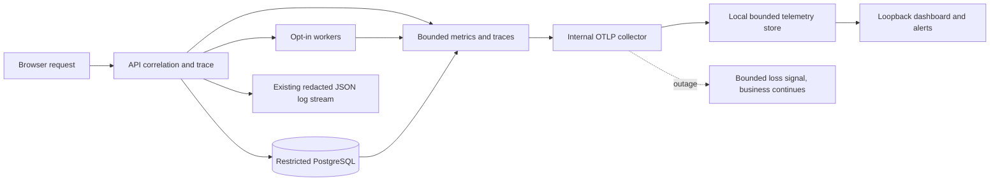

# M17 Observability and Service Health Architecture

**Current G17 checkpoint (2026-11-14):** Hosted [#43540639907](https://github.com/ekamal22/HarborOps-Enterprise-Maritime-Logistics-IT-Operations-Platform/actions/runs/43540639907) FAILED its contract test after preflight and 319 unit tests passed. The first-incident 5xx zero seed correctly emitted an extra zero-valued measurement, exposing a test that still expected one total measurement. Executable source `f174eae6b2077937c7d43a8b1f7c34ecdab9b663` requires the zero baseline and exactly one positive 5xx increment, without weakening the request-duration check. [Rerun #43541279851](https://github.com/ekamal22/HarborOps-Enterprise-Maritime-Logistics-IT-Operations-Platform/actions/runs/43541279851) passed source preflight and full campaign remains pending at this checkpoint. **G17 NOT ACCEPTED; acceptance pending.** Earlier c7 and hosted failure evidence are preserved. [Current reconciliation](M17_G17_REPOWIDE_DOCUMENTATION_RECONCILIATION_20261114.md).

**Current status (2026-11-13):** M17 is implemented as an isolated source candidate; 72 technical assertion witnesses have been authored, and source-locked disposable verification has been attempted but is not a complete G17 acceptance. Three independent S25 assertions remain. **G17 NOT ACCEPTED; acceptance pending.** [Technical readiness](M17_G17_S25_TEST_READINESS_20261113.md) | [Verification recovery](M17_G17_VERIFICATION_RECOVERY_20261113.md).

**Source candidate:** [M17 implementation candidate status](M17_IMPLEMENTATION_CANDIDATE_STATUS_20261112.md). G17 remains unverified and not accepted.

**Planning baseline:** 2026-11-12, protected main `056b3a77f6520ac7555890f4666b368ccd351d79`.
**State:** Proposed implementation architecture aligned with the **P01-P09 approved design baseline (2026-11-12)**. Numerical P02/P04/P09 limits remain provisional until verified; initial P05 local alert thresholds require evidence-based calibration. An unverified M17 implementation source candidate exists on a separate branch. An independent S25 review has occurred and returned NOT PASS. No G17 acceptance, service activation on protected main or production deployment is authorized by this plan.
**Entry:** G3 accepted. **Exit:** G17 explicitly accepted after independent source-locked evidence review.
**Authority:** [Roadmap](ROADMAP.md), [execution graph](EXECUTION_GRAPH.md), [requirements](REQUIREMENTS.md), [M17 implementation plan](M17_IMPLEMENTATION_PLAN.md), [verification matrix](M17_VERIFICATION_PLAN.md), [local policy register](M17_POLICY_PROPOSAL_20261112.md), [operations runbook](M17_OPERATIONS_RUNBOOK.md).

## 1. Actual inherited source boundary

HarborOps is a .NET 10 modular HTTP API and React web client with PostgreSQL 16 and a disposable local Compose profile. The current source already has JSON console logging with scopes and a generated per-request correlation ID in `src/HarborOps.Api/Program.cs` (response header `X-Correlation-ID` and `AuditCorrelation.Begin`). The API already provides `/health/live` without dependency checks and `/health/ready` with `DatabaseReadinessCheck` (five-second timeout and baseline seed check). These endpoints, JSON response shapes, existing client-visible correlation IDs, security controls and transactional semantics are accepted contracts. Instrument them without replacing or weakening them.

`Program.cs` also registers opt-in services: M10 projector, M11 evaluator, M13 idle cleanup, M15 dispatcher. M9 event transport still has a separately accepted operating hold. Existing M16 auditing is business/security evidence, not general telemetry. No new general incident CRUD belongs here; that is M18.

Current source does not establish an accepted OpenTelemetry pipeline, collector, multi-signal dashboard, alerting contract or full cross-service diagnostic journey. Historical successful tests for other milestones are not G17 evidence.

## 2. Architecture decision and boundaries

Adopt explicit in-process .NET instrumentation through System.Diagnostics.Metrics `Meter`, System.Diagnostics `ActivitySource`, and the OpenTelemetry .NET hosting/instrumentation/exporter packages after pinning and reviewing the compatible resolved dependency versions. The current candidate uses ASP.NET Core HTTP traces and a single custom HTTP duration histogram with fixed operation/status-class tags. This avoids collecting built-in .NET 10 metrics with request-controlled dimensions. No duplicate HTTP duration instrument is enabled. Use OpenTelemetry semantic names for built-in metrics and a stable `harborops.` namespace for custom instruments. The optional local collector receives OTLP over an internal Compose network. A separate optional dashboard/alert profile reads locally retained aggregate telemetry. There must be no default public metrics or tracing endpoint and no public receiver.

Deliver three signal classes: (a) structured JSON security-sanitized events, (b) quantitative low-cardinality metrics, and (c) bounded distributed traces. Correlation links are explicitly established at API entry and propagated through approved processing contexts without trusting a client-supplied identity. Request context is a trace parent, not authorization.

Choose a fail-open *telemetry* path: exporter unavailable, slow or full must not block business traffic, cause transaction rollback, lower the security bar or alter session state. Preserve independently fail-closed M10/M12/M15 data and audit operations. Bounded buffers may drop telemetry with a separate dropped-signal counter and clearly mark incomplete observations. No unbounded queue or long blocking flush on API shutdown.

Proposed architecture (not an installed runtime):

The diagram conveys target architecture only. Service names, dependency configuration and versions must be verified on the actual implementation SHA.

## 3. Metric and trace contracts

### Request and dependency instruments

The candidate uses a fixed-dimension `harborops.request.duration` histogram and a separate `harborops.request.failures` counter for 5xx errors. The built-in ASP.NET Core metrics collection is intentionally disabled to avoid unbounded HTTP attribute cardinality. The following table is the approved-target instrument catalogue, with candidate deviations and unimplemented instruments identified through the candidate status record:

| Instrument | Kind / unit | Safe allowed dimensions | Origin |
| --- | --- | --- | --- |
| `harborops.request.duration` | histogram / seconds | fixed operation family and status class | M17 HTTP middleware, candidate source |
| `harborops.request.failures` | counter / requests | operation family, failure class | Sanitized HTTP result classification |
| `harborops.db.operation.duration` | histogram / seconds | operation family, outcome | Restricted app DB operations, no raw SQL |
| `harborops.db.readiness` | observable gauge / 0 or 1 | dependency = postgres | Existing readiness check |
| `harborops.worker.attempts` | counter / attempts | worker kind, outcome | Only when worker opt-in and active |
| `harborops.worker.backlog.age` | observable gauge / seconds | worker kind | Authorized bounded backlog observation only |
| `harborops.notification.dispatch` | counter / batches | outcome | M15 dispatcher only when enabled |
| `harborops.telemetry.dropped` | counter / records | signal kind, bounded reason | Collector/exporter queue instrumentation |
| `harborops.service.running` | gauge / 0 or 1 | service kind | Last sampled state, not a synthetic uptime assertion |

Metric names are proposed .NET meter names and require exact collector-export mapping and version pinning. Do not assume that OTLP metric names use the same exported Prometheus family spelling. The candidate dashboard uses `harborops_request_duration_seconds_count` and `_bucket`, subject to a required real collector mapping check. M17-01 produces an exact source-to-dashboard mapping with approved units and versions before coding.

No raw path, query string, shipment reference, port text, user identifier, email, organization ID, tenant slug, session ID, raw correlation ID, UUID, exception message, SQL query, SQL parameter, connection string, integration token or arbitrary error text is allowed in metric labels. No per-user or per-tenant series. Allowed bounded dimensions require allowlist tests and a recorded maximum series bound with an overflow/unknown bucket. Unknown route keys collapse to a fixed `unmatched` operation family.

### Trace and log continuity

API entry creates server-controlled correlation scope already present. Extend it to map a standards-compliant trace/span ID and preserve the existing correlation ID for error/API/audit continuity. Accept trace context only after strict W3C header parsing, bounded baggage rejection, and sanitized sampling; never copy client traceparent, baggage, tracestate or arbitrary request headers into logs as trusted attributes. Use `ActivitySource` spans for internal work-unit boundaries (tracking accept, inbox enqueue, work claim, projection/evaluation, report build, notification delivery) with only safe operation/outcome attributes. Background work receives context from an allowlisted persisted linkage or a new internal root span, never a trusted free-form event payload.

Trace continuity must distinguish asynchronous causality from a single synchronous parent-child chain. For post-commit worker pickup use explicit `ActivityLink` to validated trace context when persisted by an approved privacy-safe mechanism; otherwise connect by restricted existing correlation evidence and disclose the gap. Do not add a migration simply to preserve trace IDs without a separate schema/security review.

Keep JSON logs on stdout/stderr under existing log filtering; correlate with trace/span IDs when present. A log message is neither an audit event nor an authorization decision. Sensitive failures use bounded classifications, not raw provider exceptions or full URL/query dumps. Support controlled fault investigation without exposing request body, cookies, CSV content, audit metadata, SQL parameters or notification text. Never log raw telemetry exporter credentials.

## 4. Health and failure semantics

Preserve existing `/health/live` and `/health/ready` routes, JSON shapes and status codes. Liveness indicates process responsiveness, not database availability. Readiness is unhealthy on database unavailability/unseeded baseline and must preserve the five-second database check budget. Add any optional dependency health signals as independent internal metrics, not as new readiness requirements. Collector downtime, optional dashboard downtime, disabled dispatcher, and intentionally held M9 transport must **not** make the API unready or create an incident by themselves.

Do not treat a disabled worker as failed. Each widget and alert declares `active`, `disabled`, `held`, `unknown` or `unavailable` separately from healthy/degraded. Guard false positives during startup, short outages, low traffic, test teardown and intentionally stopped services. Exporter failure surfaces as monitoring degradation, not application 503.

## 5. Dashboard and alert profile

The M17 dashboard is local-only, opt-in and visually distinct from M13 operational KPI dashboards. M13 represents scoped shipment/business facts; M17 represents system/service state. The telemetry profile is off in default Compose and guarded by an explicit local configuration. Use disposable Compose project names for verification and bind any UI to 127.0.0.1 with no reverse proxy exposure, no public credentials and no external SaaS dependency.

Minimum panels: API requests/sec, HTTP 5xx fraction and p50/p95 latency; PostgreSQL readiness/operation latency; active worker status, backlog age and retry/dead-letter counts where actually enabled; telemetry ingestion freshness and dropped signals; alerts by severity with evidence link to a sanitized correlation ID. Mark an absent signal as `unknown`, not healthy. Include an alert-test harness with predictable triggering and clearing.

Initial alert thresholds are approved as **local reference rules** in [M17 policy decision register](M17_POLICY_PROPOSAL_20261112.md) and require measured calibration before G17. The P02/P04/P09 numerical limits are provisional until measured. Production SLO claims, on-call routing, third-party paging, email or Slack integration and hosted dashboards are out of scope without a separate decision. Alert notifications are distinct from M15 user notifications.

## 6. Isolation, retention and performance

- Telemetry stores and collectors hold no business credentials or user sessions. Internal-only receiver and reader access. Web browser access is loopback-only in the local profile; untrusted browser origins cannot query metrics.
- Trace samples use a bounded probability, deterministic head-sampling behavior and an explicit per-service rate cap for pressure control. Failure/error spans may be prioritized only if confidentiality is preserved; verify that sampling cannot manufacture full-fidelity promises.
- No trace carries raw SQL statement, credential, personal data, query string, source event payload or arbitrary exception stack by default. A pre-export sanitizer and negative canary tests are mandatory.
- Approved **isolated local telemetry-only** retention is 24 hours or 250 MiB per standalone verification profile, whichever is reached first; scope and implementation must be validated before activation. Never apply telemetry retention to M8 immutable histories, M16 audit, M11 exception history or M15 receipts. Do not provision deletion, purge or pruning of any existing data.
- Bound telemetry overhead and queues under healthy, exporter-down, high-request-rate and large-backlog conditions; benchmark the overhead against matched baseline runs before accepting G17.
- OpenTelemetry dependency versions, transitive vulnerabilities, container privileges, local storage paths and SBOM must be checked against the implementation commit. Keep all persistent local caches, traces, browser evidence and disposable volumes E:-backed according to [storage policy](LOCAL_STORAGE_POLICY.md).

## 7. Cross-milestone contracts

| Neighbor | M17 integration rule |
| --- | --- |
| M9 | Do not lift the transport-processing hold, change retry/lease outcomes, or run sustained workers solely for telemetry |
| M10 | Projector remains opt-in; no telemetry dependency may affect correction transactions or audit |
| M11 | Evaluator remains opt-in; instrument only currently authorized work |
| M13 | Preserve accepted reporting capacity/idle cleanup and do not merge service metrics into business KPI semantics |
| M15 | Dispatcher default-off; M15 P10 fail-closed writes and P12 no deletion continue unchanged |
| M16 | Audit retains its access policy, same-transaction semantics and retention; traces cannot become an audit export |
| M18 | After G17 acceptance, consume fault evidence through an explicit future incident integration, not an M17 ticketing API |
| M19-M22 | Reuse health, performance and deployment signals without presuming any of those gates accepted |
| M24 | G17 does not replace final release or accessibility acceptance |

## 8. Evidence and source discipline

Implementation occurs on an isolated M17 branch based on the then-current protected main. Record exact source SHA and changes to Program, service instrumentation, dependency packages, optional Compose overrides, dashboards, docs and tests. No direct changes to protected main outside a reviewed merge. Avoid unrelated refactoring. Keep original historical failures and accepted upstream evidence intact.

G17 requires all 25 planned scenario dispositions, source-locked unit, contract, PostgreSQL, browser, security, outage and load evidence, verified manifests, a reviewed policy contract and an independent technical S25 assessment. A successful hosted workflow alone cannot replace raw evidence review or explicit acceptance. Do not dispatch Actions while doing planning. Documentation-only changes use `[skip ci]`.
