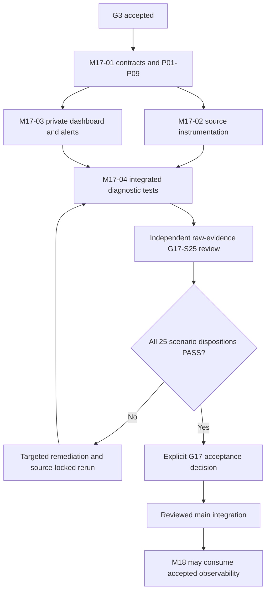

# M17 End-to-End Implementation Plan

**Current G17-S25 status, November 14, 2026:** [Hosted run #43589790235](https://github.com/ekamal22/HarborOps-Enterprise-Maritime-Logistics-IT-Operations-Platform/actions/runs/43589790235) finished **FAILED** at executable SHA `e238a48013948f28c8ab5042583e6e6bfaaa4553`. Exact-source preflight, 319 unit, 60 contract, 55 M17 integration and 34 accepted regression tests passed without required skips. Prometheus exposed a firing `HarborOpsDatabaseUnavailable` alert, but the browser did not render its label in the local Grafana alert table. The feature-branch correction sets the panel target to table format, narrows the browser witness to the actual alert panel, and adds fail-closed configuration and raw-evidence negative checks. This new candidate has **not** passed a complete hosted verification. The earlier green run #43541279851 is evidence for its own older source only. All S25-F01 through F08 remain open until new raw evidence is reviewed, and F06 requires a separate signed reviewer decision. Protected `main`, the M9 transport hold and accepted data protections are unchanged. **G17 NOT ACCEPTED; acceptance pending.**

**Current G17 technical verification (2026-11-14):** [GitHub Actions #43541279851](https://github.com/ekamal22/HarborOps-Enterprise-Maritime-Logistics-IT-Operations-Platform/actions/runs/43541279851) completed **SUCCESS** on executable source `f174eae6b2077937c7d43a8b1f7c34ecdab9b663`. The downloaded evidence reports 47/47 campaign stages passed, 25 scenario IDs, 72/72 source-bound technical assertions passed, and three independent S25 review assertions still pending. No required test was skipped. The raw suite files show 319 unit, 60 contract, 54 M17 integration and 34 regression passes. The 45-entry manifest has no missing expected artifacts, although the GitHub download omits two hidden Playwright `.last-run.json` metadata files listed in that manifest. All earlier failures and the separate c7 archive remain historical. **Technical verification GREEN; G17 NOT ACCEPTED; independent S25 acceptance pending.** [Technical evidence checkpoint](M17_G17_TECHNICAL_VERIFICATION_GREEN_20261114.md).

**Historical G17 checkpoint (2026-11-13, superseded):** The G17 coverage register has 72 authored technical assertions and three pending independent S25 clauses. [Run #43462771279](https://github.com/ekamal22/HarborOps-Enterprise-Maritime-Logistics-IT-Operations-Platform/actions/runs/43462771279) failed scoped integration with 52 passed, one failed and zero skipped: its process-wide worker span listener and shared database could include unrelated queued work. The strict two-span, single receipt and durable generation assertions remain in the corrected test. [Run #43470770246](https://github.com/ekamal22/HarborOps-Enterprise-Maritime-Logistics-IT-Operations-Platform/actions/runs/43470770246) was launched on source `a5c3af3829517ec10aed19861dc49ba936b63f97`; its final status is pending at this documentation checkpoint. All historical failed evidence is preserved. **G17 NOT ACCEPTED; acceptance pending.** [S25 readiness](M17_G17_S25_TEST_READINESS_20261113.md) | [Source-locked verification recovery](M17_G17_VERIFICATION_RECOVERY_20261113.md).

**Source candidate:** [M17 implementation candidate status](M17_IMPLEMENTATION_CANDIDATE_STATUS_20261112.md). G17 remains unverified and not accepted.

**Prepared:** 2026-11-12. **Baseline:** protected main `056b3a77f6520ac7555890f4666b368ccd351d79`.
**Status:** Planning complete at initial scope; **P01-P09 approved as the design baseline 2026-11-12**, with provisional P02/P04/P09 numeric limits and P05 local alert calibration pending measurement. An implementation source candidate is present on a separate feature branch. Partial source-locked compilation, unit, contract, frontend and integration evidence exists, but the full G17 campaign remains failed or pending and gate acceptance has not been granted.
**Gate:** G17. **Prerequisite:** G3 accepted. **Next downstream gate:** M18 requires G17 and G16.
**References:** [Architecture](M17_ARCHITECTURE_DESIGN.md), [policy choices](M17_POLICY_PROPOSAL_20261112.md), [G17 scenarios](M17_VERIFICATION_PLAN.md), [operator runbook](M17_OPERATIONS_RUNBOOK.md), [planning register](M17_PLANNING_STATUS.md).

## 1. Objective and strict scope

Deliver independently diagnosable API, PostgreSQL and opt-in worker operation using low-cardinality metrics, bounded traces, structured logs, a private local dashboard and deterministic alerts. A source-locked fault must be traceable from an HTTP request or background work item through a safe correlation identifier to the exact component/failure category and a monitoring signal. The product must continue working when monitoring is unavailable.

Do not implement M18 incident CRUD, M19 backup/restore, M20 full security certification, M21 comprehensive capacity certification, M22 deployment changes, M23 product UI polish or M24 final release/accessibility checks as part of M17. M17 requires its own bounded instrumentation performance checks; M21 later owns general scale limits.

## 2. Source and dependency preflight

Before implementation, freeze a new feature branch from the then-current `main`, recheck accepted M17 prerequisites, and record the exact source SHA. Audit current source rather than relying on this plan's date-specific snapshot:

- `src/HarborOps.Api/Program.cs`: JSON logging scopes, server-generated correlation header, exception middleware, health routes and opt-in hosted service registration.
- `src/HarborOps.Api/Health/DatabaseReadinessCheck.cs`: five-second readiness DB call and seed verification.
- `src/HarborOps.Api/HarborOps.Api.csproj`, `src/HarborOps.Infrastructure/DependencyInjection.cs`, `Directory.Build.props`: resolved .NET/EF/Npgsql versions and scoped service configuration.
- `src/HarborOps.Api/Notifications/NotificationDeliveryService.cs` plus tracking/projector/evaluator worker services: registration flags, exception handling and cancellation.
- `compose.yaml`, `scripts/smoke-compose.sh`, `docs/LOCAL_STORAGE_POLICY.md`: loopback binding, immutable source labels, restricted users, disposable Compose project discipline.
- `tests/HarborOps.UnitTests`, `tests/HarborOps.ContractTests`, `tests/HarborOps.IntegrationTests`, `tests/browser/specs`: accepted test harnesses and authorization security fixtures.

Compile a file/API ownership inventory and verify no conflicts with any concurrent feature branch. Apply the approved M17-P01 through P09 design baseline. During M17-01, check feasibility of the provisional P02/P04/P09 numerical budgets against the selected instrumentation and define an evidence-based P05 alert calibration procedure. Any substantive revision must be reviewed and recorded before G17; design approval does not establish measured performance. Pin package versions after NuGet dependency and license review; no floating dependencies or silent exporter sidecars.

## 3. M17 work package plan

### M17-01: Telemetry signal and threshold contract

**Entry:** G3 accepted.

Work:
1. Catalogue existing request, database, worker, readiness and business-audit signals. Clearly distinguish metrics/logs/traces from persisted source-of-truth.
2. Freeze each instrument name, type, unit, safe dimensions, observation owner, collection period, default behavior and missing-signal semantics. Record native .NET metric names versus exported collector names.
3. Approve finite label values and exact series cap. Specify trace format and safe correlation context.
4. Translate the approved P01-P09 design rules into measurable contracts. Establish the reference workload, sampling and buffering implementation, local retention, alert hysteresis/suppression and response ownership. Record measured calibration for P02/P04/P09 and P05 before claiming G17 conformance.
5. Publish fault-to-signal mapping for API 5xx, DB down, worker crash/stale backlog, authentication denial, exporter down and optional feature disabled.

**Deliverables:** [Approved P01-P09 baseline](M17_POLICY_PROPOSAL_20261112.md), instrument/limit measurement and revision log, stable [instrument catalog](M17_ARCHITECTURE_DESIGN.md) updated with exact versions, alert threshold fixtures, cross-system data-flow sketch and reviewed threat model. No changes to accepted data migrations.

**Verification before M17-02/M17-03:** Static contract checker verifies every instrument has source, unit, label allowlist, cap and explicit disabled/unknown state. Security review approves redaction and trace trust handling. Gate scenarios G17-S01, S02, S05, S06, S17, S24 and policy parts of S25.

### M17-02: Health, correlated instrumentation and bounded export

**Entry:** M17-01 complete and applicable policies approved.

Implementation sequence:
1. Add a narrow telemetry registration extension under `src/HarborOps.Api/Observability/` (suggested `ObservabilitySetup.cs`, `TelemetryNames.cs`, `TelemetryOptions.cs`), called from `Program.cs`. Use `IOptions` validation, with secure default-off exporters and no side effects in CLI migration/account commands.
2. Reuse existing scoped correlation ID. Integrate Activity and trace identifiers into structured logs without overwriting the accepted header or audit correlation. Treat inbound trace context as untrusted. Define validation for traceparent/tracestate/baggage.
3. Instrument selected bounded operation families, not arbitrary identifiers or raw paths. The feature branch currently uses custom HTTP duration and 5xx instruments with finite operation/status classes, and the native ASP.NET Core metrics meter is not subscribed, avoiding duplicate request aggregates. Real collector series census remains required.
4. Add safe DB latency/outcome observation around necessary operations, not raw SQL or per-tenant meters. Preserve connection pooling and transaction boundaries.
5. Add branch-guarded opt-in worker instruments. Do not instantiate or start M9 transport, M10 projector, M11 evaluator or M15 dispatcher just to sample them. Treat intentionally held/disabled as state rather than failure.
6. Configure bounded OTLP export through internal, optional collector profile. Exporter failures increment bounded drop/degradation signals and never affect business outcomes. Apply explicit shutdown budgets.
7. Keep existing health route paths and JSON/status semantics. Extend internal diagnostic signals without making collector readiness a dependency.

**Expected touched files:** `Program.cs`, `src/HarborOps.Api/Observability/*`, `HarborOps.Api.csproj`, strictly necessary selected services and their test files; only additive optional configuration. Do not alter migrations, table guards, secrets, default delivery flags or accepted API wire contracts.

**Verification:** Unit tests for options, invalid headers, correlation, sanitization, metrics/cardinality and exporter backpressure; contract tests for health and errors; restricted PostgreSQL integration and cancellation/worker continuity. G17-S03, S04, S07-S15, S17, S18, S20, S21.

### M17-03: Private local dashboard and alerting

**Entry:** M17-01 complete and applicable policies approved. Can proceed in parallel with M17-02 against mocked or recorded contract inputs, followed by actual source integration.

Implementation sequence:
1. Provide a separate, explicit `compose.m17.observability.override.yaml` or similarly named optional profile, not a default `compose.yaml` service. Add only approved pinned collector/storage/dashboard images with read-only configurations, capped persistent E:-backed test directories and loopback-only dashboard port.
2. Configure collector to accept only trusted OTLP input from project internal network. Disable public OTLP/Prometheus listener exposure and default external export. Apply resource limits, bounded queues, no sensitive log/attribute capture and documented health behavior.
3. Store validated dashboard definitions and alert rules as versioned files under `monitoring/m17/` or `ops/m17/`, with explicit data-source mappings and no hard-coded secrets.
4. Design panels for request latency/errors, PostgreSQL readiness, active worker status/lag, exporter freshness/drops and alert history. Use `unknown` when no samples exist, rather than displaying green.
5. Implement alert tests with controlled faults and bounded thresholds/cooldowns; verify active/held/disabled worker suppression. The local alert evaluator has no authority to open M18 incidents or send M15 user notifications.
6. Provide an operator-safe runbook for startup, controls, health interpretation, redaction, controlled faults, recovery and disposal of disposable evidence.

**Expected touched files:** optional Compose override, `monitoring/m17/` configuration/dashboards/rules, local verification scripts and docs. Do not add public endpoints, cloud accounts, changes to base Compose worker flags or live automation.

**Verification:** Start private stack only with explicit disposable confirmation. Assert listener visibility from loopback versus disallowed address, credentials not leaked, low-traffic absence behavior, threshold trigger and clear transitions. G17-S08, S12, S16, S19, S22, S23.

### M17-04: Source-locked diagnostic journey and G17 closure candidate

**Entry:** M17-02 and M17-03 integrated into one source-locked M17 candidate. No gate decision yet.

Implementation sequence:
1. On a newly created, explicit disposable E:-backed PostgreSQL and Compose project, verify clean install, migration/seed, API readiness, browser auth, worker defaults and optional collector startup.
2. Drive a valid shipment/browser workflow with a controlled DB outage, a service retry, a held-worker case and an exporter outage. For each, follow sanitized correlation evidence across HTTP/API/DB/worker where applicable, then dashboard/alert evidence.
3. Verify exact trace causality and limitations. Do not assert a worker span parent relationship when only a correlation bridge is available.
4. Run unit, contract, affected .NET integration, old accepted health/auth/tenant, relevant M9/M10/M11/M15/M16 and three-browser functional regressions. Scope them to changed behavior and approved integration impact; no general G13 retest unless a demonstrated compatibility change demands it.
5. Test security/privacy, injection, collection cardinality, malformed trace headers, no-collector, full queue, restart, late reply, dropped telemetry, controlled process termination, startup and shutdown.
6. Run paired reference workload benchmark with telemetry enabled/disabled. Record source SHA, exact binaries, CPU/memory/latency, sample size and limits, not a self-declared PASS without numerical evidence.
7. Collect raw .NET TRX/JSON, browser reports, alert transitions, synthetic trace/correlation records, SQL/health outputs, configuration hashes and manifest. Make artifacts individually verifiable and sanitized, without unrelated private environment data.
8. Separate implementation audit from evidence audit. Obtain an independent G17-S25 review, reconcile all 25 scenarios and remaining policy decisions, then explicitly decide G17 acceptance. Merge only when all required conditions and authorization are satisfied.

**Expected touched files:** bounded test fixtures in existing test projects, `tests/browser/specs/observability.spec.mjs`, opt-in verification script, evidence index and M17 verification/acceptance docs. Final paths must reflect real source, not this planning placeholder.

## 4. Required order and concurrency

M17-02 and M17-03 can be parallel after M17-01. The monitoring UI must not claim actual signals until bound to the real emitter and source-locked verification. Work on M14 and M19 may progress independently; M18 incident implementation requires G17 and G16.

## 5. Integration and repository hygiene

- Feature branch naming suggestion: `feature/m17-observability-20261112`. Verification and independent review may use separate branches. Never mutate accepted historical evidence branches or protected main while testing.
- Develop the opt-in monitoring service without changing default startup, M9 backlog hold, M10/M11/M13/M15 feature switches, M16 audit permissions, P10 fail-closed semantics or P12 retained rows.
- No production deploy, no external collector, no cloud accounts, no external paging, no purging existing data and no unauthorized data deletion.
- If a runtime change requires DB schema or cross-service privilege additions, stop and record a dedicated policy/security proposal instead of treating migration as implicit M17 scope.
- Tests may alter only uniquely named disposable project resources, with exact ownership and cleanup proof. No general Docker prune/volume deletion and no persistent C:-backed writes.
- No CI dispatch or implementation is authorized by this planning commit. When implementation is separately authorized, use efficient source-locked test groups and dispatch only approved workflows.
- At each implementation change record source SHA, affected files, actual tests executed and results. Preserve failed runs and all original audit records. Docs-only commits may use `[skip ci]`.

## 6. Formal entry, exit and handoff

**M17 implementation entry checklist:** current main verified; G3 accepted; P01-P09 approved design incorporated; provisional numerical limits explicitly identified for implementation measurement; signals and data-flow contracts reviewed; dependency licenses/security checked; local E:-backed environment validated; independent test reviewer appointed or procedural exception explicitly disclosed.

**G17 candidate exit checklist:** four work packages complete; default-off and privacy contracts verified; 25/25 scenario dispositions supported by exact per-assertion evidence; full impacted regression matrix passed; browser runs cover Chromium/Firefox/WebKit; failure-path diagnostic continuity demonstrable; alert trigger/clear; exporter downtime business-safe; bounded cardinality and telemetry resource budget; complete sanitized artifacts and hashes; independent S25 review; signed local policy record; explicit acceptance.

**After G17:** update [Status](STATUS.md), [Roadmap](ROADMAP.md), [Execution Graph](EXECUTION_GRAPH.md) only if the canonical graph data changes, and G17 acceptance register with exact SHA, evidence and exceptions. Then allow M18 incident workflows to use M17 signals without implicit auto-open incident/paging authority.

**Current output of this document:** The implementation plan exists; source, tests, verification run, acceptance and merge of implementation do not.
