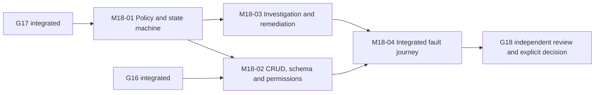

# M18 End-to-End Delivery and Implementation Plan

**Prepared:** 2026-11-18  
**Status:** PLANNED ONLY. No M18 implementation or G18 test evidence exists.  
**Planning baseline:** `main` at `72251f5310f24fb98322b7eb403a5e9e66e040ef`; recheck the branch head and shared files before implementation.  
**Technical prerequisites:** G17 integrated through PR #53; G16 integrated through PR #25.  
**Policy gate:** M18-P01 through P20 in [local policy proposal](M18_POLICY_PROPOSAL_20261118.md) remain PENDING.

## Outcome and non-negotiable scope

Deliver an authenticated, tenant-isolated, durable incident ticket workflow where authorized responders can record service impact, triage severity, investigate safe telemetry evidence, document mitigations and corrective actions, confirm restoration/integrity, resolve, close and reopen with complete immutable history. A controlled diagnostic from M17 must be capturable into a manually confirmed incident, including when M17 later becomes unavailable. All actions must preserve M16 audit atomicity and existing M9 hold, M15 delivery defaults, M17 monitoring/privacy and M2 live authorization.

This is **not** implementation authorization, G18 acceptance, or deployment. No unapproved external ITSM integration, auto-open, auto-escalation, paging or production data copy.

## Work package dependencies and delivery boundaries

M18-02 and M18-03 may proceed in separate owned branches/worktrees **after** M18-01 policy approval and contract freeze, but their schema/API/permission interfaces must be locked and conflicts reviewed. M18-04 requires both packages integrated into one exact candidate source; no mixing of test evidence from incompatible heads.

## M18-01: Policy, contract, threat model and traceability

**Input:** current G16 and G17 source and their accepted limitations; operations incident guidance; existing M2 role matrix; FR-016, FR-020, FR-002 and FR-014.

1. Recheck current `main`, pending documentation/feature branches, merge history and migrations. Create a source ownership ledger for new files and touch points including the domain policy, API, persistence, browser workspace and localization.
2. Obtain explicit P01-P20 selections. Freeze state transition graph, incident/severity enums, role/permission table, retention/archival exclusion, response/error envelope, timing, note visibility and closure exception policy.
3. Enumerate exact request and response DTOs for all planned API routes, input bounds, pagination cursor and operation-id format, idempotency expiry/reservation semantics, test hooks and state race outcomes. Resolve ambiguous 403/404/409 distinctions without existence leaks.
4. Draw data-flow and trust boundaries: same-origin session and CSRF, selected organization, API store transaction, M16 audit, optional M17 sanitized snapshot and all forbidden flows. Do not import M17 internal exporter credentials or direct Grafana query capability into business endpoints.
5. Produce a migration and grants plan including tenant-scoped composite FK, immutable histories, migration-owned M16 event taxonomy and trigger/routine capture, transaction-local authenticated actor context, centralized runtime provisioner, backward compatibility and no table cascades. Decide exact retention for incident content separately from M16 audit archival.
6. Freeze the G18 25-scenario/75-assertion matrix and independent reviewer contract before implementation, including mutation ideas tied to named assertions and source-owned evidence.
7. Review P17 exceptional false-positive path with operations and security policy. If any decision is unresolved, record BLOCKED and do not substitute a hidden developer default.

**Exit:** approved typed contract, change ownership, threat model and 25/75 assertion traceability. Until then M18-02/03 cannot claim authorization.

## M18-02: Persistent incidents, typed access and state controls

**Proposed source files (not yet existing):** `src/HarborOps.Domain/Incidents/`, `src/HarborOps.Infrastructure/Incidents/`, `src/HarborOps.Api/Incidents/`; narrow additive modifications to `OrganizationPolicy.cs`, `HarborOpsDbContext.cs`, `Program.cs`, migration and role provisioner.

1. Implement fail-closed domain state machine and deterministic validator. Make state changes command-specific, no generic patch to privileged fields; initial state `New`.
2. Add additive migration tables, indexes, unique keys, scoped FK and DB-side immutable history protection. Check EF snapshot drift, runtime role grants and a fresh/upgrade existing schema without touching accepted migrations.
3. Add typed M18 permissions. Resolve/refresh active user/session/organization/role at HTTP and inside every mutating transaction, including assignment/closure and read-after-revocation. No Administrator global tenant bypass.
4. Create `IncidentStore` or equivalent scoped abstraction with row-locks, versions, server UTC and actor/organization-scoped operation keys for create and subsequent commands. Resolve ambiguous commits using the committed key and normalized payload digest; check current permissions before replaying a successful result. Enumerate and verify the exact required M16 audit event set for every mutation, rolling back if a required entry is missing.
5. Implement list/detail/create, explicit transitions and severity/assignment routes with bounded request parsing, sanitized code-based errors, rate limiting and keyset paging. Negative same-ID foreign tenant probes must not distinguish foreign from nonexistent object.
6. Test request commit ambiguity and exact replay, competing role changes, concurrent transition writers, duplicate client retries, storage outage, required audit failure and malicious SQL grant attempts.
7. No direct HTML or arbitrary telemetry URL attachments; data exposed only through fixed DTOs with explicit visibility filtering.

**Exit:** compile clean, exact-source contract tests, fresh/upgrade PostgreSQL tests, role+revocation matrix, concurrency/idempotency/immutability tests and M16 atomic audit proof. This is technical readiness for M18-03 integration, not G18 acceptance.

## M18-03: Investigation, evidence, remediation and bilingual workspace

**Source:** incident domain/infrastructure/API modules and `web/src/incidents/`, `web/src/auth/OrganizationWorkspace.tsx`, `web/src/i18n/messages.mjs`.

1. Add append-only chronological notes with safe text limits and server-side visibility. Protect body from audit/export/log/trace leak. Denied note reads must not reveal existence, counts or author identities.
2. Implement corrective actions with typed status and version, explicit owner, evidence and no destructive edit. Root cause is nullable until investigation; resolution must record cause classification or a reviewed accepted exception.
3. Implement safe evidence snapshots for M17-derived observations. Verify rule/service allowlists, observation age, digest format, missing-signal behavior, payload spoofing and deduplication. A snapshot remains readable independent of telemetry retention.
4. Build responsive functional list/detail/triage/investigation/action/recovery/closure/reopen workflows within authenticated selected organization; guard route/render by server permission, not client role alone. Manager-created reports must remain summary-only, while Auditor read-only access requires a distinct approved grant. The user must see an explicit stale-version conflict and retain the unsent draft.
5. Provide stable active filters, explicit time-zone display, immutable timeline, stale-version conflict reconciliation, resource loading/error/empty/forbidden handling and draft preservation.
6. Register all text in shared English/Turkish strings. Verify no leaked untranslated user copy, server status enums remain unchanged, formatting keeps UTC semantics and organization switching clears previous-tenant data/cache.
7. Ensure separation between M13 KPI dashboard, M15 shipment notifications and M17 private telemetry. No new notification outbox, auto-ticket worker or external communication.

**Exit:** bilingual browser test set, correct read-only/limited/admin/support views, tracked remediation/closure/reopen, repeatable failure recovery and sanitized snapshots.

## M18-04: Controlled incident journey and G18 campaign

1. Freeze one integrated source SHA after reconciling M18-02 and M18-03. Record commit, tree SHA, migration list, dependency lock versions, image digests, exact fixture revision and verified clean working tree. Any code change requires a new source lock and impacted rerun.
2. Create a new isolated E:-backed verification directory, temporary Compose project, fresh database and two synthetic organizations with all five roles and active/revoked scenarios. Do not touch retained resources.
3. Inject a controlled permitted M17 fault through the disposable setup, capture an allowlisted signal and sanitized digest, manually confirm a ticket, triage/investigate/mitigate, restore service and check database integrity, monitor/resolve/close, then reopen with new evidence. Verify no automatic incident created merely because an alert fired.
4. Run state/permission, DB, migration/grant, event immutability, atomic audit, concurrency, idempotency, injected outage, privacy, source-integrity and three-browser English/Turkish tests. Include accepted M16/M17 regressions and M9/M10/M11/M13/M15 invariants where impacted.
5. Perform Q3 historical-volume checkpoint on **a verified disposable copy** of a representative retained backup if one exists; prove boot/read, migration/integrity spot checks and no mutation of original. If no representative snapshot exists, record NOT APPLICABLE with actual discovery evidence and reason, not PASS.
6. Add targeted effective mutants: remove tenant predicate; widen Manager or Auditor grant; bypass post-lock revocation; permit skipped transition; drop version guard; duplicate event on replay; remove required audit; disable immutable table guard; leak note/correlation; treat missing telemetry as healthy; close with missing proof. Each mutant must be killed by an identified required test, or classified transparently without falsely counting as a kill.
7. Run source-locked local verification first and preserve every failing attempt. Don't skip scenarios. Check exact evidence file hashes, distinct source claims, partial results, timeouts, environment, fixture ownership and cleanup. Never rewrite raw failed artifacts.
8. Conduct independent S25 source and raw-evidence review after technical campaign. S25-A01/A02/A03 are separate from automated pass and require a real reviewer determination and signed record. Obtain explicit G18 acceptance only after that review, and merge to protected `main` only with authorization.
9. No GitHub Actions workflow dispatch is authorized by this plan. No production activation or application hosting.

**Exit:** source-locked no-skip technical record, 75 individual dispositions (including signed reviewer assertions), negative/control evidence, Q3 disposition, independent technical review, explicit gate decision and postmerge source-equivalence check if merged.

The [proposed API/UI examples](M18_API_AND_UI_CONTRACT_EXAMPLES.md) define draft DTO, response-tier, cursor, retry and status semantics. [Policy/test crosswalk](M18_DECISION_TO_EVIDENCE_CROSSWALK.md) specifies approval sequencing and negative controls.

## Implementation-entry contract review

Before M18-02/03 source work, reconcile the [security and transaction contract](M18_SECURITY_AND_TRANSACTION_CONTRACT.md) with approved P01-P20 choices. Record per-route visibility and permission, separate Auditor grant, Manager safe summary, PostgreSQL tenant guards, M16 migration-owned triggers and grants, create-operation replay without incident ID, sensitive notes privacy residual, global-service-vs-tenant observability boundary, and closure separation. **Each unresolved choice is a blocker**, not an assumed default. New implementation claims must map to the refined [assertion inventory](M18_G18_ASSERTION_INVENTORY_20261118.json) and a specific effective negative control.

## Build/test and failure order

| Stage | Minimum evidence | Stop on |
| --- | --- | --- |
| 0. Source and policy | Base SHA, scope diff, approved policies, permissions, 75-assertion inventory | Unknown branch, unapproved choices |
| 1. Static | .NET 10 restore/build with warnings evaluated, Node dependency restore, frontend typecheck/build, migration model checks | Compile, schema, drift failure |
| 2. Fast functional | Domain unit, contract, permission negatives, input bounds, Turkish copy completeness | Any skipped/failing required check |
| 3. PostgreSQL | Fresh schema, upgrade, tenant isolation, mutable state / immutable event pairing, grants and audit rollback | Incorrect grants, unsafe migration, audit gap |
| 4. Adversarial | Competing writers, replay, stale role, CSRF, bad cursor, injection/XSS/secret canaries, role mutations | Privilege, concurrency, privacy defect |
| 5. Runtime faults | DB down/restart, collector down, expired alerts, controlled fault journey, retention independence | False success or false health |
| 6. Browser | Chromium, Firefox, WebKit, English and Turkish functional journeys, direct route and organization switch | Broken flow or hidden unauthorized operation |
| 7. Q3 and regressions | Safe historical copy or justified N/A; M16/M17 and impacted business suites | Data integrity or accepted behavior regression |
| 8. Evidence reconciliation | Source, manifest, case-to-witness map, output scans, cleanup ownership | Missing artifacts, unknown SHA, skipped mandatory assertion |
| 9. Independent review | S25 opinion with qualifications and separately signed instrument | No genuine reviewer determination or undecided exception |

**Do not label a stage PASS from a planned command, an earlier unrelated source, or a green workflow status alone.** G18-S25 is not covered by self-attestation.

## Cross-milestone guardrails and handoff

| Neighbour | Required preservation |
| --- | --- |
| M1/M2 | server-authoritative cookie session, CSRF/Origin, five roles and current selected organization |
| M8/M9 | immutable tracking provenance and 10,000-item transport hold, no worker activation |
| M10/M11 | no correction, exception or rule-effect mutation through incidents |
| M13 | operational KPI remains a distinct data product; incident count only when properly scoped and defined |
| M15 | no implicit notification fanout or default-off delivery change |
| M16 | append-only audit, atomic sensitive mutations, least privilege and original retention policy |
| M17 | internal default-off telemetry, safe finite tags, qualified P09 and independent signature condition |
| M19 | final backup/restore remains future G19 scope; Q3 is a limited snapshot check only |
| M20/M23/M24 | independent security, final visual refinement and final accessibility/release gates remain open |

Source changed after verification invalidates relevant witnesses. Record all blocking findings with ID, affected case, root cause, corrected SHA and rerun evidence; do not simply update docs to green. Reconcile roadmap, status, architecture, requirements, acceptance criteria and graph *only as necessary*, preserving historical reports. Never treat planning files or this handoff as an implicit permission to execute.

## Completion criteria and delivery artifacts

The planned M18 delivery is complete for independent review only when source, migrations, typed permissions, English/Turkish UI, 25/75 cases, fault journey, signed policy selections, Q3 checkpoint, effective negative controls, raw artifact manifest and impacted regressions are all available for the **same** source. Acceptance remains separate and explicit.

The [architecture](M18_ARCHITECTURE_DESIGN.md), [policy](M18_POLICY_PROPOSAL_20261118.md), [verification matrix](M18_VERIFICATION_PLAN.md), [machine inventory](M18_G18_ASSERTION_INVENTORY_20261118.json), [disposable runbook](M18_OPERATIONS_RUNBOOK.md) and [planning status](M18_PLANNING_STATUS.md) form one proposed packet. If a required contract changes, update every affected member together before coding.
