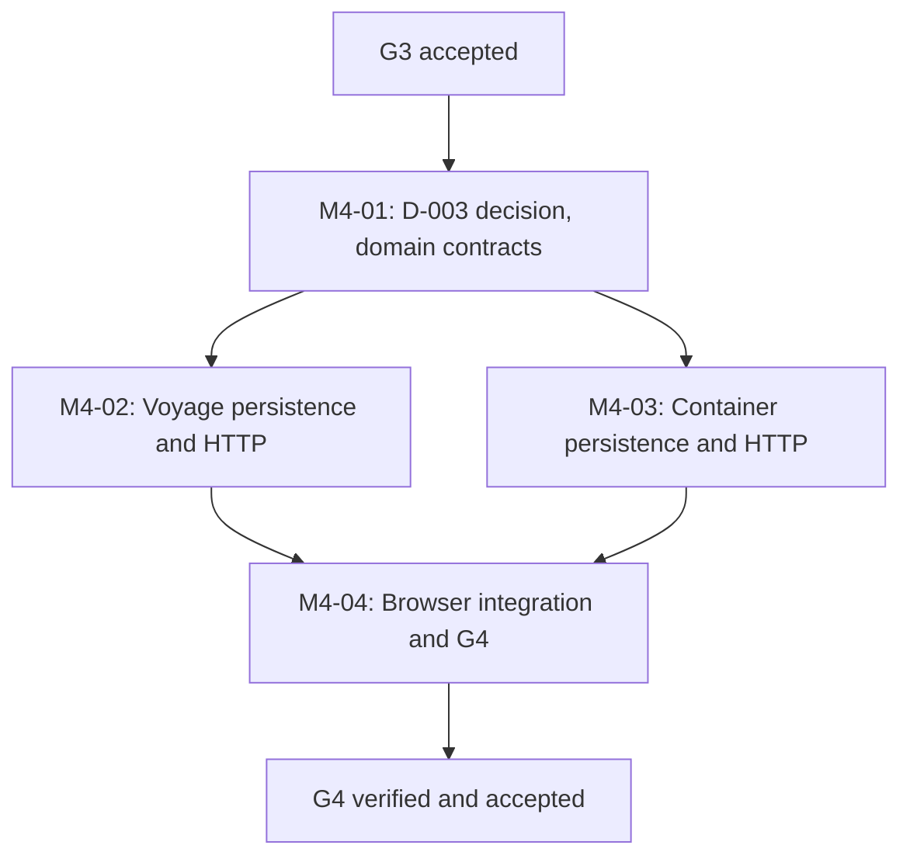

# M4 Implementation Plan: Voyage and Container References

**Milestone:** M4, M4-01 through M4-04; exit gate G4  
**Status:** M4-01 through M4-04 delivered, independently reviewed and G4 explicitly accepted on 2026-11-01. See [executed verification](M4_EXECUTED_VERIFICATION.md). D-003 Option B accepted; M4 integrated into `main`.
**Base:** Accepted G0-G3 implementation on `main` as of 2026-10-31.  
**Design authority:** [M4 architecture](M4_ARCHITECTURE_DESIGN.md), [D-003 proposal](M4_D003_CONTAINER_IDENTIFIER_PROPOSAL.md), [G4 verification plan](M4_VERIFICATION_PLAN.md), [Execution Graph](EXECUTION_GRAPH.md), [Parallel Delivery Policy](PARALLEL_DELIVERY_POLICY.md), [Storage Policy](LOCAL_STORAGE_POLICY.md).

## 1. Scope, dependencies and delivery method

G3 was the inbound gate for M4-01. D-003 was resolved by explicit Option B acceptance on 2026-11-01. After M4-01 policy approval, voyage and container implementation can progress in parallel, converging at M4-04 and G4:

Do not start M5 shipment assignments inside M4. M5 shipment lifecycle may proceed independently from G3; M6 assignment integration requires accepted G4 and G5. Do not change the execution graph to make unrelated parallel milestones wait for G4.

Planning may live on `main`. Once implementation is approved, use `feat/m4-voyage-container-references` based on a confirmed accepted `main` SHA, separate from any active M5 branch. Keep all commit subjects labeled `[skip ci]` and never run GitHub Actions or modify workflow configuration. Merge requires explicit G4 acceptance, not merely green tests.

## 2. M4-01: Resolve identifier and domain contracts

**Entry:** accepted G3. **Decision resolved:** D-003 Option B accepted on 2026-11-01.

Deliverables:
1. Explicitly decide D-003 in [Decisions](DECISIONS.md) and [D-003 proposal](M4_D003_CONTAINER_IDENTIFIER_PROPOSAL.md). Compare strict ISO-only, kind-tagged ISO+Synthetic, and local free-form alternatives; record approved standard edition, U-only or broader equipment scope, synthetic prefix, checksum, normalization, uniqueness and catalog rules.
2. Finalize `VoyageStatus` and `RecordStatus` transition table with allowed nullable UTC timestamp combinations; approve immutable parent vessel/origin/destination identities and local reference-code format.
3. Finalize `ContainerIdentifierKind`, `EquipmentType`, identity/provenance and archive rules with positive/negative examples. Keep `Synthetic` visibly labeled, and never claim BIC ownership or registry verification.
4. Freeze API v1 request/response DTOs, closed JSON property names, safe error codes, paging/filters and typed role permissions in [API Contracts](API_CONTRACTS.md).
5. Publish a migration coordination entry if M5 is running concurrently: name/order, unique indexes on M3 composites, FK ownership, reversible schema, one authoritative migration branch.
6. Approve deterministic fixture IDs and source-status labels; no primary database seeding.

Suggested tests before M4-02/03: pure domain validation, checksum vectors sourced from a pinned normative reference, canonicalization idempotence, status transition matrix, null timestamps, default/unknown state and forbidden cross-kind identifier conversions.

**Exit M4-01:** D-003 explicitly closed and domain/API contracts accepted for implementation. Design approval alone does not satisfy G4.

## 3. M4-02: Voyage persistence, scope and API

Suggested file plan:

| Path | Work |
| --- | --- |
| `src/HarborOps.Domain/Voyages/VoyagePolicy.cs` | Pure local-code, schedule/null, voyage transition, route and timestamp rules |
| `src/HarborOps.Infrastructure/Voyages/VoyageRecord.cs` | EF Core entity with organization and parent references |
| `src/HarborOps.Infrastructure/Voyages/VoyageStore.cs` | Authenticated scoped reads/writes, transactional locking and optimistic version |
| `src/HarborOps.Api/Voyages/VoyageEndpoints.cs` | Five same-origin scoped HTTP routes with bounded JSON parsing |
| `src/HarborOps.Infrastructure/Persistence/HarborOpsDbContext.cs` | New DbSet and EF mappings without changing existing M3 entity behavior |
| `src/HarborOps.Infrastructure/Persistence/Migrations/<M4 migration>.cs` | Shared, additive M4 migration coordinated with M4-03 |
| `tests/HarborOps.UnitTests/VoyagePolicyTests.cs` | Domain rule, transition and nullable UTC tests |
| `tests/HarborOps.IntegrationTests/VoyageHttpTests.cs` | Real PostgreSQL HTTP contract, ownership, authorization, versioning and lifecycle |

Implementation sequence:
1. Use unchanged M3 `PortReference` and `VesselReference` identities. Add tenant-composite unique keys to the migration and same-tenant composite FKs from voyages.
2. Add domain policy and EF mapping with closed status enums, `timestamptz`, nonempty code and temporal SQL constraints.
3. Implement `List/Get/Create/Patch/Archive`. Default `recordStatus=Active`, limit 25 and UUID keyset paging. Unknown/planned/actual timestamps remain null until explicitly recorded. Both ports and vessel are required and must be Active and in the selected organization at creation.
4. On mutations, reuse accepted M3 organization/session locking order, then lock/check parent references and target voyage. Reject concurrent parent archive and role revocation races safely.
5. Encode transition rules in one effective-state validator used by create/PATCH; reject invalid status rollback, missing actual departure/arrival, tampering with immutable route/vessel fields and stale versions.
6. Test direct SQL constraints and true foreign object UUIDs through both query and write paths. No partial writes on error.
7. Expose only safe same-organization reference summaries; avoid N+1 exposure, arbitrary global lookups and shared cross-tenant caching.

**Exit M4-02:** isolated PostgreSQL, actual API and voyage integration tests passed; final G4 acceptance was subsequently recorded on 2026-11-01.

## 4. M4-03: Container persistence, scope and API

Suggested files:

| Path | Work |
| --- | --- |
| `src/HarborOps.Domain/Containers/ContainerIdentifierPolicy.cs` | ISO checksum and synthetic-mode canonicalization under approved D-003 |
| `src/HarborOps.Domain/Containers/ContainerPolicy.cs` | Type/status/source-kind rules and immutable identity |
| `src/HarborOps.Infrastructure/Containers/ContainerRecord.cs` | EF entity |
| `src/HarborOps.Infrastructure/Containers/ContainerStore.cs` | Tenant-safe list/get/create/versioned edit/archive/restore |
| `src/HarborOps.Api/Containers/ContainerEndpoints.cs` | Five same-origin scoped routes and JSON error contracts |
| `tests/HarborOps.UnitTests/ContainerIdentifierTests.cs` | Pinned standard checksum vectors, normalization, mixed kind and invalid formats |
| `tests/HarborOps.IntegrationTests/ContainerHttpTests.cs` | Full actual HTTP, tenant uniqueness, lifecycle and concurrency |
| `tests/HarborOps.IntegrationTests/M4MigrationConstraintTests.cs` | Direct SQL CHECK/trigger checks for identifier kind, checksum, FKs and immutable identity |

Implementation sequence:
1. **Require D-003 approval** before writing identifier validation. Keep ISO-mode and Synthetic-mode disjoint, use canonicalized string identifiers, and preserve internal UUID/reference code separately.
2. Build a domain parser and independent SQL checksum test vectors. Reject invalid 11th digits, forbidden J/Z for U-only scope, all invalid synthetic patterns, whitespace/Unicode controls and unapproved external format relaxation.
3. Add additive schema, closed equipment types and full uniqueness (including archived rows). Do not store globally verified registry status.
4. Implement versioned create, display-name edit, archive and restore with the same scope and CSRF rules as M3. Identity, equipment type and provenance remain immutable after create. Reject already-archived edits and stale expected versions with 409.
5. Test organization A and B reusing identical identifiers without data crossover, and deterministic repeated synthetic fixture creation in isolated test databases.
6. Confirm no M5 shipment state, assignment interval or event storage has appeared in the M4 migrations.

**Exit M4-03:** real PostgreSQL, HTTP, direct-SQL and adverse security matrix pass for containers. This is not G4 acceptance.

## 5. M4-04: Browser and integration work

Suggested files: `web/src/voyages/VoyageWorkspace.tsx`, `web/src/voyages/voyageClient.ts`, `web/src/containers/ContainerWorkspace.tsx`, `web/src/containers/containerClient.ts`, selected-`OrganizationWorkspace` integration, `tests/browser/specs/voyages.spec.mjs`, `tests/browser/specs/containers.spec.mjs`, `tests/browser/specs/m4-races.spec.mjs`, `tests/browser/specs/m4-permissions.spec.mjs`.

1. Add Voyage and Container views only within the currently selected M2 organization context. Reuse M3 request handling and auth invalidation patterns but independently track each feature's reload, pagination and mutation generations.
2. Voyage form: choose one active same-tenant vessel and two distinct active ports; enter nullable planned UTC times; display planned and actual separately with explicit timezone context; create, edit, progress and archive/restore.
3. Container form: choose approved identifier kind and equipment type; enter number or unmistakably synthetic code; display canonical identity, synthetic label and readonly immutable fields; edit permitted label, archive/restore.
4. Analysts may read but never see mutation controls. Manager mutations must be enforced by API independently of visible controls. Other roles get sanitized denial and no protected content.
5. Delayed old-tenant responses, logout during requests, role revocation mid-refresh, server 503 and cursor race must clear protected rows and recover correctly in each browser.
6. Execute Chromium, Firefox and WebKit with isolated synthetic organizations/credentials and no stale shared state. Avoid using production or primary databases.

**Exit M4-04:** browser flows and end-to-end integration pass on all three engines. A standalone G4 acceptance decision still follows full verification.

## 6. Shared migration and API integration order

One combined M4 migration should be authored by a single coordinator, even if voyage/container entity code develops on separate branches. A safe ordering is:

1. Preflight migration collision and existing accepted M3 schema.
2. Add unique composite indexes on `ports(organization_id,id)` and `vessels(organization_id,id)` (do not change the accepted migration file).
3. Create `voyages` with composite same-tenant vessel/origin/destination FKs and immutable-field guard.
4. Create `containers` with approved identifier-kind SQL checks, full unique indexes and identity triggers.
5. Update EF model + snapshot together. Rebuild from a clean M0-M4 DB, from historical seeded M3 and repeat migration. Verify rollback to M3 preserves all accepted records, then reapply.
6. Merge other concurrent milestone migrations only after ordering is reconciled. Rehearse combined history and run all affected accepted M0-M3 regressions on the integrated SHA.

Do not reorder applied migrations or down-migrate a primary database. `M4` migration identity in the architecture is only a naming suggestion and must be checked against actual branch histories.

## 7. Correctness and security implementation rules

- Use deny-by-default `OrganizationPermission` checks: Analyst read, Manager read/write, no Administrator/Support/Auditor business bypass.
- Authorize every route, list, detail and mutation against active user/session/security version, selected org, active org and membership; verify role under transaction locks for writes and transaction-consistent scope for reads.
- Guarantee cross-tenant isolation at both SQL predicate and composite FK layers. True foreign UUIDs must not leak details; test real foreign resources, not just random IDs.
- Require `expectedVersion` for all PATCH/DELETE; perform guarded UPDATE with exactly one row transition. No upsert or implicit 200 on stale writes.
- Validate the entire effective row state on PATCH, not only individually modified fields.
- Carry `correlationId` and sanitized `code/message` envelopes through all failures. Enforce Content-Type, size/depth limits, CSRF, Origin and response no-cache behavior for protected data.
- Ensure direct SQL cannot bypass identifier, route, timing, status and immutable identity rules. Test with independent DB connections.
- Never claim actual port calls, BIC registration, official schedule, container position or vessel movement from syntax alone.
- Keep all controllable storage, Docker data, caches, browsers and evidence on E:. Never prune or modify retained primary volumes.

## 8. Verification execution and evidence

G4 must meet every [G4-S01 through G4-S25](M4_VERIFICATION_PLAN.md) requirement, plus relevant accepted M0-M3 regressions. Author an E:-only `scripts/verify-m4-local.sh` after implementation with:
- Explicit `HARBOROPS_VERIFICATION_ROOT` and active E:-backed Docker Desktop VHDX checks
- Unique disposable project/schema and no primary storage changes
- Clean Release .NET/web builds, domain/contract tests, fresh and historical migration, repeated real PostgreSQL integration tests
- All HTTP/role/tenant/adversarial and concurrent revocation checks
- Three-browser spec coverage, real outage/recovery and image/dependency scans
- TRX, Playwright JSON, stage exit TSV, SHA inventory and a strict per-scenario evidence index
- Guarded cleanup of *only* verified disposable resources, no GitHub Actions

Write `docs/M4_EXECUTED_VERIFICATION.md` **only after actual execution**, with observed counts and exact source SHA. Do not prefill PASS, invent tests or mark G4 accepted from source inspection. An independent acceptance review and explicit acceptance are required before integration into `main`.

## 9. Completion criteria

| Milestone deliverable | Ready for implementation when | Complete when |
| --- | --- | --- |
| M4-01 | G3 accepted | D-003 explicitly settled and domain/API contracts frozen |
| M4-02 | M4-01 closed | Voyage schema, API and integration tests passing |
| M4-03 | M4-01 closed | Container schema, API and SQL/HTTP tests passing |
| M4-04 | M4-02 and M4-03 implemented | Full multi-browser workflows and integration/regressions verified |
| G4 | M4-01 through M4-04 complete | Every G4 scenario genuinely PASS on one final integrated SHA, evidence reviewed, explicit acceptance recorded |

**Current state:** All M4 work packages were implemented and G4 was accepted after independent review of the tested `600d7c787da9f9cd4a70225cb3e3c38c093c0dc6` source. See [executed verification](M4_EXECUTED_VERIFICATION.md); M5 remains separately gated.
