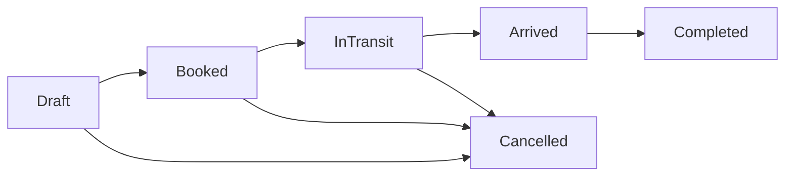

# M5 Shipment Lifecycle and Concurrency: Architecture Design

**Milestone:** M5-01 to M5-04, G5
**State:** Implemented and locally verified on the M5 feature branch; the contract decision and G5 acceptance remain pending. See [executed verification](M5_EXECUTED_VERIFICATION.md), the [contract compliance matrix](M5_G5_S01_CONTRACT_COMPLIANCE.md) and the [implementation register](M5_IMPLEMENTATION_STATUS.md).
**Baseline:** Accepted `main` at `18d00e6710097e4e31a87190be8edb65337d1b50` (G0-G4 accepted)
**Entry gate:** G3 accepted. G4 is also accepted, but M5 retains its independent G3 dependency.
**Authority:** [Roadmap](ROADMAP.md), [execution graph](execution-graph.json), [FR-004 and authorization requirements](REQUIREMENTS.md), [M4 accepted model](M4_EXECUTED_VERIFICATION.md), [M5 implementation plan](M5_IMPLEMENTATION_PLAN.md), [G5 verification plan](M5_VERIFICATION_PLAN.md).

## 1. Bounded scope and explicit exclusions

M5 adds create, read, update, state transition, archive, restore, and bounded search of shipments belonging to one organization. It does not add shipment-to-container links, shipment-to-voyage links, booking integrations, external registration checks, tracking event intake, historical event projections, exception rules, CSV export, analytics, or new integration credentials.

M6 owns assignment intervals and overlap/route constraints. M7-M10 own tracking contracts, inbox, worker and derived timelines. M12 owns advanced shipment search and CSV. M16 owns the general audit-log service. The M5 workflow status is **operator-entered administrative progress**, not an asserted physical cargo location, carrier acknowledgment, or the later event-derived tracking projection.

Existing M4 port, vessel, voyage and container contracts remain unchanged. Shipment origin/destination ports are M3 references and are **not** the M6 voyage assignment. No new FK from `shipments` to M4 `voyages` or `containers` is allowed in M5.

## 2. Domain data contract

The proposed `ShipmentRecord` is organization-owned and contains:

| Field | Rules |
| --- | --- |
| `id` | Nonzero immutable UUID, primary key |
| `organizationId` | Immutable UUID, active scoped organization on creation |
| `referenceCode` | Required, immutable, canonical `ReferencePolicy.Code` (3-32 uppercase A-Z, 0-9 or separated hyphens) |
| `externalReference` | Optional, immutable, normalized uppercase local customer/carrier reference, 1-80 ASCII characters from `[A-Z0-9._/-]`, without a claim of registry validity |
| `displayName` | Optional user-facing label, 1-160 characters without control characters |
| `originPortId`, `destinationPortId` | Required, distinct immutable M3 port UUIDs from the same organization; must be Active when shipment is created |
| `plannedDepartureAtUtc`, `plannedArrivalAtUtc` | Independently nullable, explicit UTC instants; if both exist, departure must precede arrival |
| `workflowStatus` | Closed enum `Draft`, `Booked`, `InTransit`, `Arrived`, `Completed`, `Cancelled`; initial `Draft` |
| `recordStatus` | `Active` or `Archived`; independent from workflow status |
| `sourceKind` | `Synthetic` or `UserProvided`; immutable and not a trust/registry assertion |
| `version` | Positive bigint initialized to 1, incremented once for every committed update/archive/restore |
| `createdAtUtc`, `updatedAtUtc` | Server UTC, immutable creation time, monotonic update time |
| `archivedAtUtc` | Nullable server UTC, set on archive and cleared on restore |

`ShipmentStatusChange` is an append-only, organization-owned record with immutable `id`, `shipmentId`, `organizationId`, `fromStatus` (nullable on initial insert), `toStatus`, shipment `version`, `changedAtUtc`, and `changedByUserId`. It logs explicit M5 manual workflow transitions and creation only. It is not an accepted external tracking event and must not masquerade as the M8 event history or M16 general audit trail. Each creation or workflow transition must atomically persist its corresponding status change in the same transaction. A status-neutral edit/archive/restore must not fabricate a transition.

Identity and uniqueness are per organization, *including archived rows*. Reserve `(organization_id, reference_code)` and non-null `(organization_id, external_reference)`; the same values may exist in unrelated organizations. The external reference is optional and scoped, not a universal shipment identifier. Archive never releases a reference.

### 2.1 Lifecycle

Only adjacent forward transitions and cancellation from Draft, Booked, or InTransit are allowed. Completed and Cancelled are terminal; no rollback or resurrection through workflow editing. An unchanged `workflowStatus` may accompany an edit but does not add a status change. Creation always starts in Draft. A no-op patch is rejected; edits that actually persist changes increment the version once.

Archive and restore change **record visibility**, not workflow status, and require exact `expectedVersion`. Archive is allowed at any current workflow status in M5 while there are no assignment/event dependents. Archived records are read-only except a one-field, version-guarded restore to Active. M6 must add transactional dependent-reference checks before it allows archive of allocated records. For this reason M5 must not make unconditional future archival promises.

An inactive M3 port remains a valid historical reference for existing shipments. M5 creates only against two current Active ports but does not block their later M3 soft archive, rewrite their UUID, or automatically alter shipment workflow status. Port labels may be returned as scoped read projections; an Auditor viewing shipments may not call the unrelated M3 port management endpoint.

### 2.2 Time and status distinction

UTC values must carry an explicit `Z` or zero offset and be stored as `timestamptz`. Null means unknown, never midnight or an invented estimate. Planning times may change while the shipment is Draft or Booked, but become immutable once it enters InTransit. M5 never sets actual arrival/departure based on a status transition and never computes ETA. M9/M10 event-derived status must use a separate projection and cannot silently overwrite `workflowStatus`.

## 3. PostgreSQL and EF Core 10 design

Create **one additive M5 migration**, strictly after `20261101010000_VoyageContainerReferences`. Reserve a new migration timestamp at implementation time; do not invent or collide with an independently developed migration ID. Change only the current EF model and the matching snapshot, never previously applied M0-M4 migration files.

- `shipments`: PK `id`; FK `organization_id -> organizations.id` with RESTRICT; composite FKs `(organization_id,origin_port_id)` and `(organization_id,destination_port_id)` referencing the already accepted composite-unique M3 port identities, with RESTRICT. Add a composite unique key `(organization_id,id)` for M6 assignment FKs.
- Unique indexes `(organization_id,reference_code)` and `(organization_id,external_reference)` where the external reference is not null. Add indexes for `(organization_id,record_status,id)`, `(organization_id,workflow_status,id)`, and selected scoped origin/destination lookups. All app queries must include organization predicates even when FK constraints exist.
- SQL CHECK constraints validate enum memberships, version positive, reference lengths/canonical formats, distinct origin/destination, planned window ordering, and archival timestamp consistency.
- A PostgreSQL BEFORE INSERT, UPDATE and DELETE trigger rejects invalid creation and modifying immutable identifiers, tenant ownership, origin/destination and source, disallowed workflow transitions, version jumps, invalid scheduled-window edits, direct mutation of archived rows except a valid restore, and direct DELETE. The service still validates all invariants before SQL.
- `shipment_status_changes`: composite FK `(organization_id,shipment_id)` to shipments, unique `(organization_id,shipment_id,version)`, constrained status values, append-only triggers to reject UPDATE/DELETE, and bounded organization/shipment/version indexes.
- Preserve transition history atomically: use a database-controlled insert hook or a deferred transaction-validated invariant ensuring that each creation/status transition creates exactly one matching change row, with no forged transition row. The implementation must prove the chosen mechanism under direct SQL, not merely assert application-level dual writes.
- Historical M4 upgrades, M5 rollback-to-M4 and reapply must preserve every M0-M4 record, session, selected organization, reference and migration checksum. Never down-migrate a retained primary database.

Do not add foreign keys, date intervals, or assignment rows for `voyages`/`containers`. No outbox, tracking inbox, data projections, audit-service migrations or new generalized role-grant tables are in M5 scope.

## 4. Authorization and concurrency contract

Add `OrganizationPermission.ViewShipmentData` and `ManageShipmentData`, separate from M3/M4 reference permissions. The existing [authorization matrix](REQUIREMENTS.md) requires Analyst and Manager to view and modify scoped shipments; Auditor has a read-only role grant for shipments, not a broad grant to maritime references. Implement explicit static typed permissions only for the M5 scope:

| Role | Shipment read | Shipment create/update/archive/restore |
| --- | --- | --- |
| Analyst | Allow | Allow |
| Manager | Allow | Allow |
| Auditor | Allow via explicit `ViewShipmentData` role mapping | Deny |
| Administrator | Deny; management role alone is insufficient | Deny |
| Support | Deny; no dynamic business-data grant in M5 | Deny |

Do not reinterpret "explicit grant" in the requirements as a new dynamic role-grant system. Such a general grant mechanism needs separate design and approval; M5 grants Auditor read-only access through a narrowly typed shipment-view permission. No Auditor access to M3/M4 endpoints is implied.

Every HTTP request must verify active account, authoritative server session, expiries, security version, selected organization, active membership, active organization and typed permission; `orgId` alone never authorizes. Fail closed on missing PostgreSQL; use consistent sanitized 401/403/404/409/503 with correlation IDs. Same-origin JSON writes use the accepted antiforgery and Origin/Fetch Metadata validation. Every response is `Cache-Control: no-store`.

**Write lock order:** organization row FOR UPDATE; session row FOR UPDATE; user row FOR SHARE; live membership/role resolution; relevant M3 parent rows or their organization-level archival serialization; target shipment row. Membership changes, organization suspension, account disablement, session revocation and shipment writes must revalidate **after** the blocking lock is obtained and serialize against the accepted M2-M4 locking discipline. Cancellation must never commit an incomplete transition/history pair.

**Optimistic concurrency:** every PATCH, DELETE and restore requires positive `expectedVersion`. Under competing writes, at most one matching-version transition succeeds and the other returns 409. Stale duplicate calls fail rather than replay a mutation. A repeated POST with the same reference code returns a sanitized 409 without duplicate rows. Missing or foreign shipment UUIDs return 404 without leaking existence. SQL unique, FK, transition and trigger violations are mapped to stable error outcomes, never unhandled HTTP 500.

## 5. HTTP contract

Use `/api/v1/organizations/{organizationId}/shipments`, matching accepted minimal API routing:

| Method | Path | Action | Success |
| --- | --- | --- | --- |
| GET | `/shipments` | List scoped, bounded results | 200 |
| GET | `/shipments/{shipmentId}` | Detail including scoped port display fields | 200 |
| POST | `/shipments` | Create initial Draft | 201 |
| PATCH | `/shipments/{shipmentId}` | Edit mutable fields or advance workflow status with `expectedVersion` | 200 |
| DELETE | `/shipments/{shipmentId}` | Soft archive with `expectedVersion` JSON body | 204 |
| GET | `/shipments/{shipmentId}/status-changes` | Read ordered manual workflow history in current organization | 200 |

Restore uses `PATCH` with only `recordStatus: Active` and an exact version. Any other edit to an archived row is rejected.

Create fields: `referenceCode`, optional `externalReference`/`displayName`, required `originPortId`, `destinationPortId`, nullable `plannedDepartureAtUtc`, `plannedArrivalAtUtc`. Reject incoming `version`, `organizationId`, actual timestamps, tracking status, `containerIds`, `voyageId`, event records, status-history author/timestamps and unknown fields.

PATCH fields: `expectedVersion` plus optional mutable display name, planning times (before InTransit), or `workflowStatus` transition. Immutable identity, externalReference and route cannot be updated in M5. A change to workflow status appends one status-history entry.

GET list supports `q` (bounded prefix/substr search on local/external reference and display name), `recordStatus` (Active default, Archived, All), optional `workflowStatus`, `after` (UUID keyset), and `limit` (1-100, default 25). Sort on immutable `id` with a stable filter contract and `nextAfter` cursor. M12 owns more elaborate search combinations, exports and report pagination. Validate repeated/unknown parameters, Unicode/control characters, wildcard treatment, case normalization, invalid dates and UUIDs.

The error envelope uses `{code,message,correlationId}` and no internal SQL, secrets or unscoped parent existence. Contract DTOs must not serialize internal membership/security fields.

## 6. Browser and service design

Add `src/HarborOps.Domain/Shipments/ShipmentPolicy.cs`, `src/HarborOps.Infrastructure/Shipments/ShipmentRecord.cs`, `ShipmentStore.cs`, `src/HarborOps.Api/Shipments/ShipmentEndpoints.cs`, and `web/src/shipments/ShipmentWorkspace.tsx` with typed `shipmentClient.ts`. Wire through existing `Program.cs`, `DependencyInjection.cs`, `HarborOpsDbContext.cs` and `OrganizationWorkspace.tsx` without disturbing accepted maritime APIs.

The web workspace supplies an organization-scoped list, filter, keyset next page, detail, draft create form, permitted transitions, editable Draft/Booked fields, archive/restore confirmation, manual status change history, optimistic-version conflict recovery, and clear busy/empty/denied/stale/degraded states. Analyst and Manager may edit; Auditor sees a read-only shipment view. Port selection uses accepted M3 catalog only for roles allowed those routes; Auditor detail shows already scoped shipment port descriptors, not M3 reference-edit controls.

Reset selection, pending mutations, page cursors and cached rows on organization or role changes, logout, revocation and browser navigation. Ignore active-tab no-op clicks; guard stale asynchronous list responses, cancellation and overlapping Refresh. A failing optional port selector must not hide an otherwise available read-only shipment list.

**Drafts and refresh.** Unsaved edits must survive the user leaving and returning to the browser tab. A refresh (tab becomes visible, explicit refresh) updates the list in place and checks the open shipment without clearing the form. A newer server version of the open shipment is held aside and reported; it is never applied to the form on its own. "Load current version" merges field by field: fields the user did not touch follow the server, fields the user edited keep the draft, fields the server also changed are reported as collisions, and edits that can no longer be saved (a status that is no longer reachable, a schedule locked by transit) are reported and not applied. Saving with a stale version is rejected by the exact-version check and keeps the draft. Closing, switching or creating while a draft exists asks for confirmation. The organization workspace revalidates membership, role and organization quietly on visibility and clears protected state, and with it any draft, when the organization, the role or access changes or access is rejected. Organization switch, role change and logout drop all shipment state. The merge rules live in a pure module with unit tests (`web/src/lib/shipmentDraft.mjs`).

The formal keyboard, contrast, screen-reader and accessibility assessment remains at M24-04. G5 tests functional browser state and authorization, not a dedicated accessibility gate.

## 7. Decisions to confirm before implementation

This architecture introduces no new global D-number in the accepted execution graph. Before code is written, approve or revise these **M5-local** contract choices as one implementation design decision:

1. Manual `Draft -> Booked -> InTransit -> Arrived -> Completed` lifecycle, with cancellation from Draft/Booked/InTransit.
2. Required origin/destination active M3 ports and independently nullable planned UTC dates; no M4 voyage/container assignment.
3. Narrow shipment-only Auditor read grant, plus Analyst/Manager read and write. Support/Administrator denied by default.
4. Immutable tenant-local and external references, record archival with independent workflow status, and append-only manual status changes.
5. Simple search/pagination in M5; advanced export and tracking projections deferred.

These choices formed the initial implementation contract in source and have been executed and audited (see the [compliance matrix](M5_G5_S01_CONTRACT_COMPLIANCE.md)), but they have not received a separate formal design-decision entry or G5 acceptance. Independent review of the evidence and the explicit decision remain required. See [M5 implementation status](M5_IMPLEMENTATION_STATUS.md) and [source audit](M5_SOURCE_CORRECTNESS_AUDIT.md). Consult the [implementation plan](M5_IMPLEMENTATION_PLAN.md) and [G5 verification plan](M5_VERIFICATION_PLAN.md) before beginning implementation.
