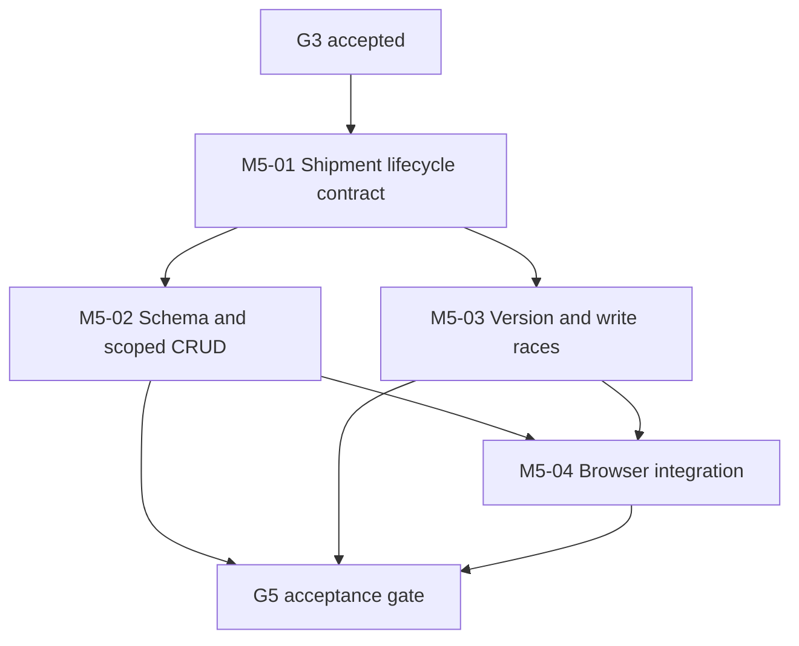

# M5 Shipment Lifecycle: Implementation Plan

**Status:** Fully implemented and verified at `3e57af490d9a28dd1f0c482b6d20cd44f8a9fc91`. M5/G5 accepted 2026-11-02 and fast-forward integrated into `main`. Historical implementation steps below are retained; see [G5 closure](M5_G5_GATE_CLOSURE.md).
**Feature branch:** `feat/m5-shipment-lifecycle`
**Accepted base:** `main` at `18d00e6710097e4e31a87190be8edb65337d1b50`
**Work packages:** M5-01, M5-02, M5-03, M5-04, then G5
**Scope authority:** [M5 architecture](M5_ARCHITECTURE_DESIGN.md), [G5 plan](M5_VERIFICATION_PLAN.md), [Roadmap](ROADMAP.md), [execution graph](execution-graph.json), [Status](STATUS.md).

## 1. Delivery graph and parallel work

The accepted graph deliberately makes **M5 depend on G3, not G4**. Accepted G4 supplies reusable maritime conventions but is not added as a prerequisite. M5-02 and M5-03 can be implemented in parallel after M5-01 with coordinated API, migration ownership and test contracts. G4 and G5 are now accepted, so M6 may proceed with its own separate G6 verification requirements. Do not rewrite the execution graph into a serial milestone chain.

G5 and fast-forward M5 integration were explicitly authorized on 2026-11-02. The accepted work is on `main` without GitHub Actions. Local run 13 evidence is preserved against its exact source SHA; documentation-only commits use `[skip ci]`.

## 2. M5-01: Freeze shipment lifecycle contract

**Entry:** G3 accepted; M5-local architecture choices approved.
**Deliverable:** Shipment domain invariants and explicit HTTP/authorization contract, with no database migration yet.

- Implement `src/HarborOps.Domain/Shipments/ShipmentPolicy.cs`: reference normalization, external reference validation, closed `workflowStatus` and `recordStatus`, explicit zero-offset UTC parsing, coherent nullable planned windows, immutable identity and legal state transitions.
- Keep manual workflow progress distinct from tracking-derived status. No M7-M10 events or projections.
- Implement explicit role rules via `OrganizationPermission.ViewShipmentData` and `ManageShipmentData` in the existing M2 policy; Analyst/Manager read and manage, Auditor shipment read-only, Administrator/Support default denied. No new dynamic grant store.
- Freeze v1 request/response names from the architecture. Use `expectedVersion` rather than introducing untested `If-Match` behavior.
- Specify status-history storage as internal manual transitions, atomic with shipment update, never as tracking history.
- Document exact active/inactive port parent rules, archival invariants, duplicate reference policy and optional external identifier semantics.

**Tests:** `ShipmentPolicyTests` must exhaust the transition matrix, terminal states, invalid status strings, reference canonicalization, malformed UTF/control characters, UTC offsets, null/partial planned windows, date ordering, archive/restore invariants and the five-role permission matrix. A policy-only unit test must not be mistaken for authorization evidence.

**Exit:** Signed-off contract for M5-02/M5-03 implementation. This plan itself is not that approval.

## 3. M5-02: Schema, commands and HTTP read/write paths

**Entry:** M5-01 frozen. **Migration coordination:** one writer for the M5 PostgreSQL migration.

| Planned location | Implementation |
| --- | --- |
| `src/HarborOps.Infrastructure/Shipments/ShipmentRecord.cs` | Shipment aggregate and append-only manual status-change record |
| `src/HarborOps.Infrastructure/Shipments/ShipmentStore.cs` | Scoped reads, create/edit, transitions, archive/restore and paginated status-change reads |
| `src/HarborOps.Infrastructure/Persistence/HarborOpsDbContext.cs` | EF mappings, tenant/composite FKs, indexes, constraints |
| `src/HarborOps.Infrastructure/Persistence/Migrations/<new-M5-ID>_ShipmentLifecycle.cs` | One additive migration after accepted M4 |
| `src/HarborOps.Infrastructure/Persistence/Migrations/HarborOpsDbContextModelSnapshot.cs` | Exact current model snapshot without suppressing EF drift |
| `src/HarborOps.Api/Shipments/ShipmentEndpoints.cs` | Six scoped Minimal API routes and strict JSON/CSRF/error envelopes |
| `src/HarborOps.Infrastructure/DependencyInjection.cs` and `src/HarborOps.Api/Program.cs` | Scoped service registration and endpoint map, no changes to accepted routes |

Implementation sequence:

1. Build the domain policy and DTO input parser. Reject unknown/duplicate JSON fields, invalid content type, oversized JSON (8 KiB maximum), invalid arrays/objects, non-UTC times, forbidden client-controlled identity/version/timestamp data and imported container/voyage assignments.
2. Implement the SQL migration, tenant-composite port foreign keys, unique and index strategy, version/immutable/transition triggers, status-history append-only guarantees, and snapshot. Check query translation and effective column/index names against the real migration.
3. Implement transactional scoped access using the accepted organization/session/user/membership lock order. Ensure a port can be selected only when active at create time and archival cannot rewrite existing references.
4. Implement GET list/detail/status-changes. Filter tenant in SQL before cursor/paging. Return bounded DTOs, never raw auth/membership entities. Make foreign or absent shipment IDs indistinguishable.
5. Implement create initial Draft, PATCH editable fields/status, DELETE soft archive and PATCH restore, all with atomic version and status-history effects. Map SQL conflict paths to sanitized 409/400 rather than leaking DB details.
6. Add nullable planning dates and status-change history fixtures to deterministic seed preparation, without modifying the retained bootstrap row or any accepted M0-M4 migration.
7. Exercise fresh M0-M5 migration, seeded M4-to-M5 upgrade, downgrade on a disposable clone, reapply, and drift detection. Do not down-migrate the retained primary database.

**Transaction requirement:** Status-history insert and shipment mutation commit or roll back together. Test crash/fault injection just before and after the status-history write. No partial state or duplicate transition may survive. The chosen database-side integrity mechanism must reject direct-SQL attempts to silently alter workflow without corresponding status history.

**Exit:** CRUD, SQL constraints and all negative authorization tests pass on disposable PostgreSQL.

## 4. M5-03: Optimistic concurrency and adversarial serialization

**Entry:** M5-01 frozen. Can develop concurrency tests and version-guard logic alongside M5-02; merge only after their shared contract is stable.

- Require positive `expectedVersion` for each PATCH, DELETE and restore. Check the version after taking locks, not before.
- Acquire organization/session/account/membership/target row locks in the prescribed order. Revalidate live role, selected organization, account status and security version after any blocking lock wait.
- Ensure concurrent same-version edits and duplicate archive/restore requests commit only once. The loser gets a stable 409, with no ghost history row or accidental version bump.
- Archive vs status transition; restore vs edit; concurrent create of same normalized reference; competing route state changes; and queued role/account/organization revocation must serialize safely.
- Repeat read/list while a concurrent write or role downgrade is blocked; protect against cross-tenant page mixing and unauthorized stale reads.
- Preserve accepted M4 isolation/authorization semantics and existing historical migrations.
- Make test outcomes deterministic through observed PostgreSQL lock waiters/barriers, not timing-only sleeps or `Task.WhenAll` without checking the winning order.

**Tests:** `ShipmentConcurrencyTests`, `ShipmentRevocationInterleavingTests`, `ShipmentSqlInvariantTests`, and direct HTTP boundary matrices. Mutation-test tenant filtering and post-lock role/account revalidation by deliberately removing each safeguard in isolated disposable runs; the relevant tests must fail.

**Exit:** All serializable/adversarial negative cases pass and the resulting rows/history remain consistent.

## 5. M5-04: React workspace, fixtures and end-to-end journey

**Entry:** M5-02 and M5-03 implementation complete.

- Add `web/src/shipments/shipmentClient.ts` and `ShipmentWorkspace.tsx`, integrate into `OrganizationWorkspace.tsx` for Analysts, Managers and shipment-view Auditors. Do not display M3/M4 business reference workspaces to Auditor.
- Implement list/filter/next-page, detail, Draft create, planned-time edits, permitted workflow transitions, archive/restore, version conflict refresh, and read-only manual status history.
- Load list independently of optional port-selector requests; a failed port catalog must not suppress valid shipment reads. Guard stale responses by organization, role, list filter, cursor and generation. Active-tab clicks must not strand loading states.
- Display empty, loading, success, version conflict, forbidden/revoked, invalid reference and dependency-unavailable states, with correct clearing after logout, tenant switch or server-side revocation.
- Seed at least two organizations and five roles in disposable M5 fixtures, including matching reference codes in different organizations, archived historical rows, progression records and changed session selections. Fixture rerun must leave row identities and versions unchanged.
- Run same specs in Chromium, Firefox and WebKit. Do not rely on first-page ordering or shared hardcoded unique IDs across engines.
- Keep accessibility-focused WCAG/manual screen-reader audit in M24-04; functional keyboard input can be used where necessary for workflows but is not a standalone earlier accessibility gate.

**Exit:** G5 browser CRUD, security/tenancy, version-conflict and stale-response suites pass on all three engines; M0-M4 regression browser coverage remains green.

## 6. G5 local verification pipeline

Author `scripts/verify-m5-local.sh`, `scripts/assert-g5-evidence.mjs`, `scripts/prepare-m5-browser-fixtures.mjs` and relevant outage checks. Adapt the accepted G4 runner without modifying its historical evidence. The final run must:

1. Verify clean feature worktree and capture exact SHA, tool versions and E: storage/Docker VHDX state.
2. Refuse takeover of existing verification containers, volumes or retained databases. Use a distinct disposable Compose project and standalone M5 evidence directory.
3. Compile .NET 10 Release with warnings as errors; run all unit, contract, fresh and repeated PostgreSQL integration tests, including accepted M0-M4 suites.
4. Build React/TypeScript production assets and run deterministic shipment fixtures and every browser spec in all three engines, even after one browser spec fails.
5. Test real PostgreSQL outage/recovery, scoped 503 behavior, session/role denial, cleanup, dependency checks and Trivy against actual PostgreSQL/API/web images.
6. Produce unmodified per-test TRX, per-engine Playwright JSON, raw console logs, migration/snapshot diffs, query/lock traces, stage ledger and executable G5-S01 to G5-S25 evidence index.
7. Audit the test harness for exact role/tenant coverage, fixed-ID collisions, concurrency false positives, missing scenario-to-test mapping and false green outcomes. Run focused mutation tests.
8. Archive the original evidence on E: without renaming it after an unrelated source SHA. Generate a SHA-256 manifest of all raw evidence, a final bundled ZIP and source provenance.
9. Confirm zero disposable containers and volumes after teardown. Record pre/post C:/E: free space and any unavoidable short-lived C: writes. Delete only specifically attributable task-created temporary files after copying required evidence to E:, never broad system or application caches.
10. Obtain an independent raw-evidence review and explicit G5 acceptance before any merge to `main`.

**G5 truthfulness:** A test named in code is not an executed PASS. Evidence-present is not accepted. An incomplete mandatory case prevents G5 acceptance even if the runner returns success. Do not claim G5 complete based on design or a subset of suites. Record `acceptance pending` until explicitly approved.

## 7. Correctness checkpoints and risks

| Risk | Design control | Blocking verification |
| --- | --- | --- |
| Shipment foreign key points to another organization | Composite same-tenant port FKs and scoped queries | Existing real foreign parent rows, direct SQL and HTTP |
| Existing reference is archived during create | Organization transaction lock shared with M3 archival | Observed concurrent archive/create interleavings |
| Different roles from M4 | New explicit shipment permission enum entries, full five-role negative test | Auditor view-only; Analyst/Manager write; Admin/Support denied |
| Terminal-state bypass | Domain and PostgreSQL trigger both reject invalid transition | Direct SQL and service/HTTP transition matrix |
| Workflow transition loses history | Atomic commit and DB-enforced history integrity | Fault injection, direct SQL and repeat verification |
| Stale or duplicate updates | Version check after row locks; unique tenant identifiers | Two writers, retries, replays, archive/restore races |
| Tenant list leak or pagination gaps | Bound q/limit, tenant scope before keyset cursor, stable UUID ordering | Foreign cursor, wildcard, 100+ rows, multi-role browser |
| Stale UI after tenant switch | Request generation checks, scoped state reset, no-store | Deferred response and logout/role-change browser races |
| Integration with M4/M6 | Additive migration, no assignment columns, unchanged prior APIs | All M0-M4 regressions, schema diff, future combined M5/M6 test |
| Local storage and Docker leaks | E:-rooted caches, disposable resource ownership | Storage manifest, cleanup assertions, no orphan containers |

## 8. Work package acceptance checklist

| Work package | Required completion evidence |
| --- | --- |
| M5-01 | Frozen status/domain/role/HTTP contract and exhaustive pure policy tests |
| M5-02 | Additive, drift-free migration; tenant-scoped CRUD; SQL constraint and full HTTP matrix |
| M5-03 | Deterministic stale-write, duplicate, archive, ref-archive and revocation races |
| M5-04 | Two-tenant five-role fixtures and all three browser engines with correct error/race behavior |
| G5 | 25/25 scenario evidence independently reviewed, fresh/repeat regressions, clean scans, cleanup, explicit acceptance |

**Current status:** Source files, migration, tests, browser fixtures, outage script and G5 runner are committed on the M5 branch. No successful build, real migration, local browser matrix or 25-case raw evidence is available. [M5 implementation status](M5_IMPLEMENTATION_STATUS.md) and [source audit](M5_SOURCE_CORRECTNESS_AUDIT.md) enumerate remaining runtime and test-coverage work. Neither G5 acceptance nor merge is implied.
