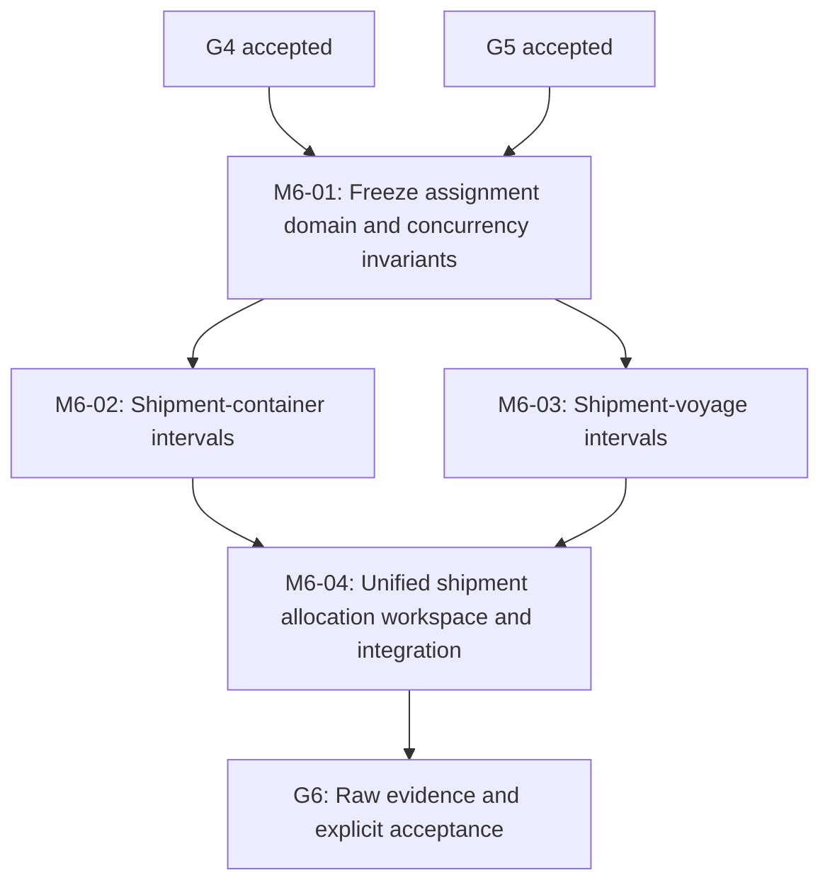

# M6 Implementation Plan: Shipment Container and Voyage Assignments

**Status:** Source implementation committed on the feature branch under this plan and executed locally on `a94d7cd406a93806527d28ba7d2ce2d6ba3307b6` (see [executed verification](M6_EXECUTED_VERIFICATION.md)). The twelve-rule contract and G6 were explicitly accepted on 2026-11-02; M6 was merged into `main`. See [implementation status](M6_IMPLEMENTATION_STATUS.md).
**Prepared:** 2026-11-02
**Branch:** `feat/m6-container-voyage-assignments`
**Accepted upstream:** G4 and G5 on `main` at `344c6eb96a9af600b5843cc97c56a8449174bad8`
**Authority:** [M6 architecture](M6_ARCHITECTURE_DESIGN.md), [M6 contract](M6_LOCAL_CONTRACT_DECISION.md), [G6 plan](M6_VERIFICATION_PLAN.md), [graph](execution-graph.json), [storage policy](LOCAL_STORAGE_POLICY.md)

## 1. Delivery structure and sequencing

M6-02 and M6-03 are parallelizable **only after** the local contract has been approved and shared API, migration ownership, parent guard and lock-order designs have been frozen. They may independently author domain/store/endpoint/tests, but must not concurrently edit `HarborOpsDbContext`, the model snapshot, a shared migration, `Program.cs`, shared organization policy or shipment workspace. One integration coordinator owns shared edits. Do not change the accepted graph to imply M6 waits for unrelated milestones.

Implementation source was expressly requested after planning and is committed separately from `main` against the proposed local contract. The contract and G6 were subsequently explicitly accepted on 2026-11-02. Merge authorization was separately granted and integration completed.

## 2. M6-01: Freeze invariant and integration contract

**Inputs:** accepted M4/M5 source and migrations; G4/G5 raw evidence and decision records; FR-005.

**Required deliverables**

1. Obtain explicit approval or revisions of all twelve [M6 local contract rules](M6_LOCAL_CONTRACT_DECISION.md). G6-S01 remains incomplete until the decision is recorded.
2. Confirm the interval model with boundary vectors: `[10:00,11:00)` and `[11:00,12:00)` allowed; `[10:00,11:00)` and `[10:59,12:00)` conflict; open-ended `[10:00,)` conflicts with any later start for the same exclusive key. Reject zero-length, reversed, implicit/non-UTC and all unknown status values.
3. Lock the asymmetric multiplicity: one container to at most one shipment per intersecting period; many containers per shipment; one voyage per shipment per intersecting period; many shipments per voyage. Closed historical associations remain durable.
4. Decide and document direct-route matching, known nonoverlapping planned windows, terminal shipment/voyage policy and parent archival blocking. Ensure every condition is achievable from the browser without bypassing version guards.
5. Validate real `btree_gist` extension availability and `uuid` GiST equality support on an isolated PostgreSQL 16 instance; pin required PostgreSQL catalog assertions and extension ownership on rollback.
6. Reconcile concurrent direct SQL parent archival versus link creation, including potential lock inversion. Define a database-enforced solution with deterministic adverse tests before allowing code implementation to claim race safety.
7. Freeze typed permission matrix, organization-selected route shapes, 8 KiB JSON body contract, UTC error semantics, labels visible to Auditor, and stable 409 outcomes.
8. Reserve collision-free M6 migration ID after `20261101180000_ShipmentLifecycle`; identify any parallel branches requiring migration coordination. Do not edit accepted M0-M5 migrations.
9. Record affected inherited contracts and exact filenames before splitting M6-02 and M6-03.

**Tests authored with M6-01:** domain/UTC interval table, half-open overlap oracle, voyage route and schedule matrix, terminal/archive decision matrix and five-role permissions. Tests are source only until executed.

**Exit M6-01:** complete accepted local contract plus reviewed shared migration and locking design; no unresolved conflicting business semantics.

## 3. M6-02: Container allocation implementation

**Owned source (until integration):**
- `src/HarborOps.Domain/Assignments/AssignmentPolicy.cs` (shared pure policy with M6-03 via single coordinated owner)
- `src/HarborOps.Infrastructure/Assignments/AssignmentRecord.cs` (container entity)
- `src/HarborOps.Infrastructure/Assignments/AssignmentStore.cs` (container service methods)
- `src/HarborOps.Api/Assignments/AssignmentEndpoints.cs` (container routes)
- `tests/HarborOps.IntegrationTests/AssignmentContainerTests.cs`, `AssignmentSqlMatrixTests.cs`, `AssignmentConcurrencyTests.cs`

**Implementation checklist**

1. Add strongly typed tenant-owned assignment entity with nullable end, actor references, version and monotonic UTC timestamps; no hard-delete.
2. Add tenant-composite FKs to accepted M5 shipments and M4 containers, indexes and the GiST exclusion on `(organization_id,container_id,tstzrange)`. Confirm an exclusion error is converted to sanitized 409 rather than 500.
3. Add immutable-record trigger allowing one null-to-value end transition with strict `expectedVersion`. Refuse parent reassignment, start edits, second closure and SQL DELETE.
4. In a single transaction, validate selected tenant, active session/security version, Analyst/Manager assignment manage permission, active shipment and container, and current parent eligibility under the organization-first lock protocol.
5. Guard direct and API archiving of containers or shipments with open links; a later historical closed link must not prohibit allowed archive. Keep accepted M4/M5 behaviors for unallocated records.
6. Implement scoped list/detail/create/close endpoints. Reject foreign or guessed ids, malformed JSON, unapproved fields, invalid intervals, stale versions, duplicate and overlapping requests.
7. Unit-test all interval edges; independently test direct PostgreSQL SQL constraints/triggers; repeat concurrent overlapping inserts from separate sessions, same-tenant and cross-tenant controls.
8. Verify status-neutral parent edits do not rewrite allocation history and do not quietly change M5 workflow history.

**Exit M6-02:** code compiles and real container allocation SQL and HTTP tests pass on isolated G6 resources; *not* G6 closure.

## 4. M6-03: Voyage association implementation

**Owned source (until integration):**
- `src/HarborOps.Infrastructure/Assignments/ShipmentVoyageAssignment.cs`
- `src/HarborOps.Infrastructure/Assignments/AssignmentStore.cs` (coordinated voyage methods)
- `src/HarborOps.Api/Assignments/AssignmentEndpoints.cs` (coordinated voyage routes)
- `tests/HarborOps.IntegrationTests/AssignmentVoyageTests.cs` and dedicated SQL/race variants.

**Implementation checklist**

1. Add tenant-owned voyage link entity, composite FKs to M5 shipment and M4 voyage, index strategy and exclusion for `(organization_id,shipment_id,tstzrange)`. Multiple shipments may use the same voyage.
2. Enforce strict shipment/voyage origin and destination equality, Active parents, voyage status Planned/Underway and non-disjoint complete planned windows. Preserve nullable planned times without guessing.
3. Add immutable target/start and one-time versioned closure with correct historical reads.
4. Add M6 voyage parent guards: archive/cancel/arrive cannot leave an open voyage link, and shipment archive/cancel/complete cannot leave an open container or voyage link. Verify M4 and M5 statuses and DB history are not auto-translated.
5. Revalidate current session and membership after locking. A role downgrade or selected organization change while queued must fail closed.
6. Implement list/detail/create/close HTTP endpoints; use only typed assignment read/write permissions, not Manager-only voyage modification or Administrator bypass.
7. Test competing voyage associations on one shipment, adjacent intervals, cancelled or archived parent, archived foreign UUID, route reversal, partial UTC windows, concurrent parent transition and rollback.
8. Prove by SQL catalog and direct invalid statements that application-only checks are not the final enforcement layer.

**Exit M6-03:** code compiles and real voyage association SQL/HTTP/concurrency tests pass in isolation; *not* G6 closure.

## 5. Shared migration and source ownership

Only one integration coordinator may alter the following files for the assembled M6 implementation:

| Shared file | Required change |
| --- | --- |
| `src/HarborOps.Infrastructure/Persistence/HarborOpsDbContext.cs` | Map two new entities, scoped composite FK keys, index fields and constraints; preserve old mappings |
| `src/HarborOps.Infrastructure/Persistence/Migrations/<M6-ID>_ShipmentAssignments.cs` | Exactly one additive migration, GiST exclusions, validation and parent guards |
| `src/HarborOps.Infrastructure/Persistence/Migrations/HarborOpsDbContextModelSnapshot.cs` | Match current EF mappings without rewriting old migrations |
| `src/HarborOps.Domain/Organizations/OrganizationPolicy.cs` | Add only two assignment-specific typed permissions |
| `src/HarborOps.Infrastructure/DependencyInjection.cs` | Register scoped assignment service |
| `src/HarborOps.Api/Program.cs` | Register M6 route group and retain M0-M5 middleware and error handling |
| `src/HarborOps.Infrastructure/Shipments/ShipmentStore.cs` | Parent archive/terminal-state guard under existing transaction |
| `src/HarborOps.Infrastructure/Maritime/MaritimeStore.cs` | Parent voyage/container archive and terminal-state guard |
| `web/src/shipments/ShipmentWorkspace.tsx` | Integrate independent M6 panels without disturbing M5 unsaved-draft rules |
| `tests/browser/playwright.config.mjs` | Preserve all M0-M5 cases, add G6 reporter output without dropping any engine |

Before merging parallel code, reconcile both parts against the same accepted M5 HEAD, run the full EF model-drift check, inspect migration SQL and enforce that no old migration, identifier function or accepted trigger is replaced.

**No parallel uncoordinated snapshot edits, migration filenames or shared API method signatures.**

## 6. M6-04: End-to-end allocation workflow

Proposed user journey:

1. Analyst signs in and selects an active organization.
2. Create a Draft shipment with accepted M3 route ports or open an existing Active shipment.
3. Open shipment assignments panel; select an Active M4 container with a valid D-003 identifier.
4. Enter explicit UTC start and optional end, create allocation, and verify scoped list/detail and version 1.
5. Select a route-compatible Active M4 voyage, create a nonoverlapping voyage association.
6. Open another session; attempt overlapping container assignment to a different shipment or competing voyage for the same shipment; observe stable 409 and unchanged histories.
7. Close the associations using exact versions; verify they remain in history and no auto-generated workflow/actual timestamp appears.
8. Archive parent records only after closure; restore using accepted M4/M5 version rules. Read archived historical associations without reopening.
9. Repeat as Auditor in read-only mode and as Support/Administrator with denied access; repeat with a second tenant with matching reference codes.
10. Switch organization and log out while a list/detail request is in flight; verify no old tenant rows or drafts reappear.

React panels must have independent loading, stale response suppression, conflict and busy states. Show a visible distinction between open interval, ended interval, planned voyage status and manually entered shipment workflow. Parent lifecycle conflict must be actionable, never disguised as 500 or silent loss of edits.

**Exit M6-04:** complete Chromium, Firefox and WebKit allocation tests, coupled M4/M5 UI regressions and source audit are green on the final assembled implementation.

## 7. G6 local verification and acceptance

Use `E:\HarborOps-Verification\m6` for all controllable persistent test state. Dedicated resources must be disjoint from G5: Docker Compose project `ho-verify-g6`, disposable integration DB `ho-g6-pg`, SDK `ho-g6-sdk`, browser cache, NuGet/npm/temporary files and evidence. Never touch `E:\HarborOps-Verification\m5` archives or existing Docker resources. Verify Docker Desktop data resides on E:. No broad C: cleanup; if C: attribution is uncertain, record it.

Implement G6 runner and stage ledger with preflight, exact SHA, source/migration check, fresh and M5-upgrade migrations, same-database repeat integration, strict build and unit/contract suites, frontend npm locked build, two-tenant fixtures, three browsers, concurrency/SQL adverse cases, snapshot checkpoint, dependency and image scans, PostgreSQL outage/recovery, immutable raw logs, SHA-256 manifest and owned teardown. Do not run or trigger GitHub Actions. All commits use `[skip ci]`.

**Quarter checkpoint G6-Q1:** inventory safely for a representative historical PostgreSQL snapshot or backup. If present, clone to disposable E:-backed storage, check origin/version/hash, boot copy, migrate with M6 and read representative M0-M5 rows, then tear down without touching the original. If unavailable, store `NOT APPLICABLE` with the discovery evidence and reason, not an invented PASS and not an executed skipped test. Do not check existing Docker volumes on every commit.

Security mutation controls must demonstrate that removing an effective tenant predicate, database exclusion or post-lock revalidation makes named tests fail. An equivalent mutation due to redundant layers needs explanation and another meaningful mutation. Gate checker must reject missing per-engine tests, empty TRX, wrong SHA, stale decision records, missing cleanup or a falsely claimed snapshot.

The mandatory [G6-S01 to G6-S25](M6_VERIFICATION_PLAN.md) matrix must be executed on **one final source SHA**. If a test fails, fix the underlying defect, audit correctness and rerun full verification at the new SHA. Preserve prior failed runs under their own identifiers.

**Acceptance outcome:** The implementation and technical evidence were completed, the entire twelve-rule M6 contract and G6 were explicitly accepted on 2026-11-02, and M6 was merged into `main` under separate authorization. See [gate closure](M6_G6_GATE_CLOSURE.md).

## 8. Failure-mode and correctness audit checklist

- Stale tenant selection or membership revoked after request is queued.
- Shipment, container or voyage archived while an assignment is inserted.
- Voyage status transitioned to terminal while association remains open.
- Shipment becomes Completed or Cancelled while allocations remain open.
- Overlapping intervals inserted concurrently under READ COMMITTED with different API sessions.
- Adjacent `[)` intervals and open-ended ranges in both time orders.
- Foreign valid UUIDs in every path, body, cursor and parent reference.
- Constraint exceptions (including PostgreSQL `23P01`, `23503`, `23514`) mapped to sanitized conflict/error, not 500.
- Direct SQL bypass attempts to update starts, targets, versions or history, plus DELETE.
- Trigger lock-order inversion, SQL deadlock, cancellation and process interruption mid-transaction.
- EF model/snapshot mismatch, extension rights, migration rollback/reapply and accepted historical row preservation.
- Browser stale response, filter and pagination races, M5 unsaved drafts, role downgrade and logout.
- Outage recovery, evidence completeness, retained Docker resource ownership, E:/C: storage attribution.
- Q1 historical snapshot checkpoint with honest NOT APPLICABLE when none exists.

## 9. Deliverables and reporting

At implementation handoff provide: source branch and base SHA, accepted M6-local contract, final migrations/EF snapshot and endpoint contracts, conflict/lock model, test source, per-engine browser results, execution gate index, Q1 snapshot finding, source SHA, final evidence archive SHA-256, storage before/after and teardown. Report every unresolved behavior and skipped case. Implementation, executed verification and acceptance are recorded in [M6 executed verification](M6_EXECUTED_VERIFICATION.md) and [gate closure](M6_G6_GATE_CLOSURE.md).
